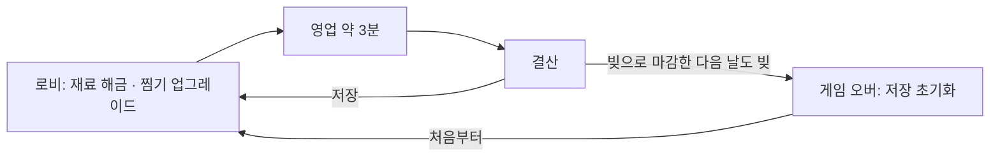
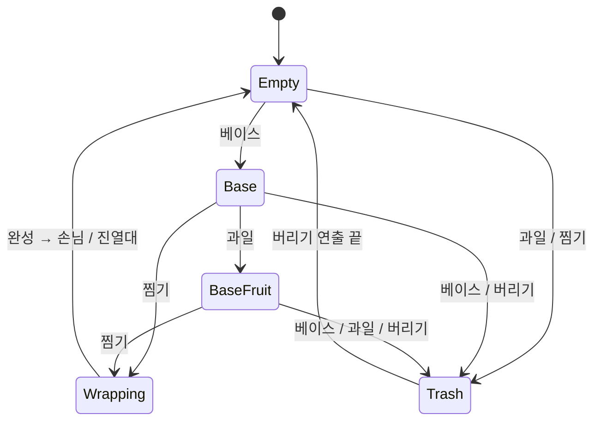

# AIGame — 게임 기획서 (GDD)

> 2026-11-22 · v1.4 — 아트 방식 결정 반영: 손님 외형 5종, 작업대 조합 이미지(ADR-0010 보완).
> 2026-11-19 · v1.3 — 설계 단계 결정 반영(근거: docs/02_design/architecture.md 'GDD 수정 목록', ADR-0004~0017). 수치 초안은 Data/*.csv, 산정 근거는 docs/02_design/data-schema.md.
> 2026-11-18 · v1.2 — 빚 · 파산(게임 오버) 규칙 반영, 재료 비활성 · 최소 자금 보장 삭제 (초안: GDD_draft.md).

## 개요
- 장르: 가게 운영 시뮬레이션 (하루 약 3분 영업)
- 플랫폼: Android (세로)
- 가제: 모찌 메이커
- 한 줄 소개: 베이스와 과일을 하나씩 해금해 가며, 손으로 모찌를 조립해 파는 과일모찌 가게 운영 게임.

## 핵심 루프
- 영업 루프 (초 단위): 주문 확인 → 베이스 클릭 → 과일 클릭(선택) → 찜기 클릭(떡으로 감싸기) → 완성품이 손님 또는 진열대로 → 골드
- 성장 루프 (일 단위): 영업 → 결산 → 재료 해금 · 찜기 업그레이드 → 더 비싼 조합, 더 빠른 제작

## 조작
- 탭만 쓴다. 재료통 · 작업대 · 찜기는 엄지가 닿는 화면 하단에 둔다.
- 영업: 재료통의 베이스 → (과일) → 찜기 순서로 탭
- 로비: 해금 · 업그레이드 · 영업 시작 버튼

## 게임 규칙 · 진행

### 재료와 조합
- 베이스: 팥(기본), 요거트, 두바이초코
- 과일: 딸기, 블루베리, 파인애플, 망고
- 조합 = 베이스 1개 + 과일 0개 또는 1개 (최대 3 × 5 = 15종)
  - 가능: 팥 / 팥+망고 / 두바이초코 / 두바이초코+블루베리
  - 불가능: 팥+팥 / 팥+두바이초코 / 재료 없음 / 망고+블루베리 / 망고 단독
- 해금 순서 (한 번에 다음 1개만 살 수 있음): 딸기 → 블루베리 → 요거트 → 파인애플 → 망고 → 두바이초코
- 뒤에 해금되는 재료일수록 해금 비용 · 재료비 · 판매가가 높다. 비싼 조합일수록 이익도 크지만, 쓰레기로 만들면 잃는 재료비도 크다.
- 요거트 · 파인애플 · 두바이초코를 해금하면 하루 임대료가 오른다(경제 > 임대료).

### 경제
- 판매가
  - 베이스 단일 (예: 팥): 베이스 판매가
  - 베이스 + 과일 (예: 팥+딸기): (베이스 판매가 + 과일 판매가) × 혼합 배수. 배수는 잠정 1.25, 밸런스 조율 때 확정(Balance.csv의 MixMultiplier). 결과는 정수로 반올림.
- 재료비 = 베이스 + 과일 + 떡. 재료를 클릭해 작업대에 올리는 순간 차감한다.
- 재료는 골드와 상관없이 항상 고를 수 있다. 재료비 때문에 골드가 0 아래로 내려가면 빚이 된다.
- 임대료: 하루 임대료 = 기본 임대료 + 해금한 재료의 임대료 증가분(요거트 · 파인애플 · 두바이초코). 영업 시작 때 낸다(영업 화면 골드에 바로 반영). 결산 순이익 = 매출 − 재료비 − 임대료.
- 빚과 파산
  - 골드가 0보다 적은 동안 영업 화면 상단 중앙(로비에서는 골드 옆)에 "파산위기!" 표지판을 띄운다.
  - 결산에서 골드가 0보다 적으면 "다음 날 영업이 끝날 때까지 빚을 갚지 못하면 파산" 경고를 보여 준다.
  - 빚인 채로 하루를 마친 다음 날, 결산에서도 골드가 0보다 적으면 파산(게임 오버)이다. 판정은 결산 때만 한다(영업 도중 잠깐 빚이 되는 것은 괜찮다).
  - 로비 구매(해금 · 찜기 업그레이드)는 골드가 비용 이상일 때만 가능하다. 빚은 재료비와 임대료로만 생긴다.
  - 임대료가 오르는 재료를 해금한 직후에는 실수가 많으면(비싼 조합을 자주 버리면) 하루 순이익이 0 아래로 떨어져 파산할 수 있다.

### 손님
- 일차별 간격으로 도착한다. 대기열은 최대 5명이다(일차별 MaxQueue).
- 손님은 사람 이미지 5종(남 2 · 여 3) 중 하나(무작위)로 그린다. 고정 이미지이며 움직이지 않는다.
- 주문은 두 종류다.
  - 조합 주문: 해금된 베이스 중 가중치로 1개, 과일(없음 포함) 중 가중치로 1개
  - "아무거나": 일차별 확률로 등장. 재고가 있으면 진열된 모찌 중 무작위 1개(하나하나 같은 확률 — 많이 쌓인 조합이 잘 뽑힌다)를 바로 집어 가고, 없으면 기다렸다가 새로 완성된 것을 가져간다.
- 도착했을 때 원하는 재고가 있으면 대기열이 꽉 차 있어도 바로 사 간다(줄을 서지 않는다). 재고가 없고 대기열이 꽉 차면 그 손님은 오지 않는다.
- 인내심이 다하면 떠난다(매출 없음).

### 제작 (작업대 1개 + 찜기)
- 정상 로직: 베이스 클릭 → 과일 클릭(선택) → 찜기 클릭(떡이 재료를 감쌈) → 완성
- 완성품 배분: 그 조합을 주문한 손님과 "아무거나" 손님 중 먼저 온 손님에게 판매. 기다리는 손님이 없으면 진열대 재고. 진열대는 조합당 5개까지이며, 그 조합이 이미 5개면 폐기한다(결산 폐기 수).
- 쓰레기 판정: 정상 로직이 아니면 전부 쓰레기. 그때까지 쓴 재료비는 손실.

| # | 작업대 상태 | 입력 |
|---|---|---|
| 1 | 비어 있음 | 과일 |
| 2 | 베이스 | 베이스 |
| 3 | 베이스+과일 | 과일 |
| 4 | 비어 있음 | 찜기(떡) |
| 5 | 베이스+과일 | 베이스 |

- 버리기 버튼 (작업대 오른쪽 끝): 작업대 위 재료를 직접 쓰레기로 처리한다. 만들던 조합을 그만둘 때, 잘못된 재료를 눌러 재료비를 더 쓰는 대신 바로 비우는 편의 기능이다. 재료비는 손실되고 결산의 쓰레기 수에 포함된다. 작업대가 비어 있으면 무시한다.
- 쓰레기 연출: 모자이크 이미지로 바뀐 뒤 화면 아래로 버려진다. 실패 효과음은 Should.
- 입력 잠금: 작업대 연출(재료 올리기 · 감싸기 · 쓰레기) 중에는 재료통 · 찜기 · 버리기 입력을 무시한다. 일시정지 버튼은 항상 동작한다.

### 찜기 (떡 공급)
- 찜기에는 게이지(떡 개수)가 있다. 찜기를 누를 때마다 떡 1개가 작업대로 가고 게이지가 1 줄어든다(쓰레기 4번도 떡 1개 소모).
- 게이지가 0이 되면 정해진 시간 동안 떡을 새로 찐다(찹쌀가루 붓기 · 찌기). 이 동안 찜기 클릭은 무시하고, 끝나면 게이지가 최대치로 찬다.
- 찜기 업그레이드: 게이지 최대치 증가 · 다시 찌는 시간 단축

### 하루 진행
- 시작 조건: 1일차, 시작 골드(StartGold), 팥만 해금, 찜기 1레벨
- 영업 종료: 남은 재고와 작업대 위 재료는 폐기하고 대기 중인 손님은 돌아간다(당일 생산 · 당일 판매).
- 승리 / 실패 조건: 목표는 6단계 해금 완료. 달성하면 로비의 다음 해금 자리에 '모든 재료 해금'을 표시하고 게임은 계속한다. 실패는 파산(빚으로 마감한 다음 날도 빚으로 마감) 한 가지다. 파산하면 게임 오버 팝업 → 저장을 초기화하고 로비 1일차부터 다시 시작한다.
- 진행: 일차가 오를수록 손님 도착이 빨라지고 "아무거나" 비율이 바뀐다(Days.csv).

## 화면 구성 (UI)
1. 로비(상점): 일차 · 골드, 다음 해금 1개(이름 · 비용 · 임대료 증가분), 찜기 업그레이드(다음 레벨 수치 · 비용), 영업 시작
2. 영업 (위 → 아래)
   - 상단: 남은 시간 · 매출(좌상단), "파산위기!" 표지판(상단 중앙, 빚일 때만), 일시정지(우상단)
   - 손님 대기열: 가로로 줄 선 손님 최대 5명(사람 고정 이미지). 머리 위 말풍선에 주문(베이스 아이콘 + 과일 아이콘, 또는 "아무거나") + 인내심 게이지. 앞사람이 떠나면 한 칸씩 당겨진다.
   - 제작 메모: "베이스 → 과일(선택) → 떡"
   - 진열대: 3행 × 5열. 칸 하나 = 조합 하나(베이스 이미지 위에 과일 이미지를 겹친 제품 이미지 + 진열 개수 숫자). 처음 진열된 순서로 한 행(5칸)씩 채우고, 개수가 0이 되면 칸을 빼고 뒤 칸을 당긴다. 행이 n개일 때 k번째 행은 진열대 높이의 k/(n+1) 위치(1행: 중앙, 2행: 0.33 · 0.67).
   - 재료통: 왼쪽 열에 해금된 베이스(팥 · 요거트 · 두바이초코, 칸 높이를 낮게), 오른쪽에 해금된 과일을 최대 2줄(딸기 · 블루베리 / 파인애플 · 망고). 두 영역의 전체 높이를 맞춘다.
   - 작업대(오른쪽 끝에 버리기 버튼) + 찜기(작업대 오른쪽, 게이지 표시)
3. 결산(팝업): 매출, 재료비, 임대료, 순이익, 판매 수, 놓친 손님 수(인내심이 다해 떠난 손님), 쓰레기 수, 폐기 수, (빚이면) 파산 경고, 다음 날로
4. 게임 오버(팝업): "파산" 문구, 처음부터 버튼 → 로비 1일차
- 일시정지 오버레이: 일시정지 버튼 또는 앱 복귀 시 "계속하기" (영업 화면 위에 표시)
- 화면 수: 로비 · 영업 · 결산 · 게임 오버 4개로 필수 조건(4개 이하)의 상한. "메인 화면"은 로비를 뜻하며, 별도 타이틀 화면을 만들면 상한을 넘는다.

| 레이아웃 예시 (재료통) | | |
|---|---|---|
| 팥 | 딸기 | 블루베리 |
| 요거트 | | |
| 두바이초코 | 파인애플 | 망고 |

베이스 통의 높이를 줄여, 베이스 3행의 총 높이와 과일 두 행의 총 높이가 알치하도록 한다. (전체 해금 기준)

## 기획 수치
수치는 Data/*.csv로 관리하고 DataTable로 불러온다. 여기에는 표 목록과 각 표의 용도만 적는다.

| 파일 | 용도 | 주요 컬럼 |
|---|---|---|
| Data/Ingredients.csv | 재료 정의. 한 줄 = 재료 하나. 조합 15종은 해금된 재료로 자동 계산 | 행 이름(재료 enum 이름), DisplayName, UnlockOrder(0=기본), UnlockCost, Cost, Price, OrderWeight, RentIncrease. 베이스 / 과일 구분은 코드, 이미지는 BP |
| Data/Days.csv | 일차별 영업 난이도. 마지막 행 이후는 마지막 행을 반복 | 행 이름(일차), Duration, ArrivalMin, ArrivalMax, Patience, MaxQueue(1~5), AnyOrderRate |
| Data/Steamer.csv | 찜기 레벨별 성능과 업그레이드 비용 | Level, MaxGauge, RegenTime, UpgradeCost |
| Data/Balance.csv | 전역 상수 (한 행: Default) | StartGold, RiceCakeCost, NoFruitWeight, MixMultiplier, PlaceTime, WrapTime, TrashTime, MaxStockPerRecipe, BaseRent |

## 저장
- 저장할 데이터: SaveVersion, Day, Gold, UnlockStep(해금이 순차라 정수 하나), SteamerLevel
- 저장 시점: 결산 확정 직후, 로비에서 구매 직후, 앱이 백그라운드로 갈 때(영업 중에는 진행 값이 영업 시작 때와 같으므로 로비에서 저장한 것과 결과가 같다)
- 영업 중 진행은 저장하지 않는다. 백그라운드로 가면 일시정지하고, 강제 종료되면 그날 영업을 처음부터 다시 한다.
- 파산 위기는 따로 저장하지 않는다. 로비에 저장된 Gold가 0보다 적으면 위기 상태다(로비에서는 골드가 늘지 않으므로 전날 결산 결과와 같다).
- 게임 오버가 확정되면 그 즉시 저장을 초기화한다(게임 오버 화면에서 앱을 꺼서 피하는 것 방지).
- 알려진 한계: 위기 상태인 날 영업 도중 앱을 강제 종료하면 그날을 처음부터 다시 할 수 있다. 5일 범위에서는 막지 않는다.

## Must 기능과 예상 시간 (필수 조건: 5개 이하, 합계 20h 이내)

| ID | 기능 | 예상 |
|---|---|---|
| M1 | 영업 시뮬레이션 코어: 하루 타이머, 손님 도착 · 주문(조합 / 아무거나) · 인내심 · 이탈, 만료 시각 이벤트 큐 | 5h |
| M2 | 제작 상태 머신: 정상 로직 · 쓰레기 판정 5종 · 버리기 · 입력 잠금, 재료비 차감, 찜기 게이지 · 재생성, 완성품 배분(손님 / 진열대 · 상한과 폐기 / 아무거나 무작위) | 4h |
| M3 | 해금 · 찜기 업그레이드 · 경제: 데이터 테이블 4종, 순차 해금, 판매가(혼합 배수) · 재료비 · 임대료 계산, 빚 · 파산 판정과 저장 초기화, 로비 구매 | 3h |
| M4 | 저장/로드 · 앱 생명주기: SaveGame(버전 필드), 저장 시점, 백그라운드 일시정지 | 2h |
| M5 | UI: 로비 · 영업 · 결산 · 게임 오버 · 일시정지, "파산위기!" 표지판 (UMG, 사람 작업). 연출은 이미지 교체와 짧은 이동 · 페이드 수준 | 6h |
| | 합계 | 20h |

## 범위 (5일)
- Must: M1~M5
- Should: 효과음 (완성 · 판매 · 쓰레기 실패음)
- Could: 단계별 세부 모션 (앙금이 작업대에 깔림 → 베이스가 과일을 감쌈 → 찰떡이 감쌈, 찜기에 찹쌀가루 붓기 · 찌기, 쓰레기 던지기 궤적)
- Won't: 오프라인 수익, 손님 캐릭터 이동 · 애니메이션, 로컬 푸시 알림, 광고 · 결제 · 서버

## 모바일 특화 요소
- 한 손 탭 조작, 세로 레이아웃(조작 영역 하단 배치)
- 앱 백그라운드 진입 시 영업 일시정지와 진행 값 저장

## 기술 포인트
1. 이벤트 기반 영업 시뮬레이션 (M1): 손님 도착 · 인내심 만료 · 찜기 재생성 완료 · 작업대 연출 끝 · 영업 종료를 만료 시각 기준 최소 힙 하나로 관리하고 Timer 하나로 다음 이벤트만 예약한다(Tick 없음). 매 프레임 전체 검사 O(n) → 다음 이벤트 확인 O(1), 넣고 빼기 O(log n). 영업 규칙은 현재 시각을 인자로 받아 월드 없이 자동화 테스트한다.
2. 작업대 상태 머신과 입력 잠금 (M2): 정상 전이 외에는 모두 쓰레기로 보내는 상태 전이표, 연출 중 입력 잠금으로 연타 예외를 막는다. 전이표를 그대로 자동화 테스트로 검증한다.
3. 완성품 배분 (M2): 도착 순 대기열 하나를 앞에서부터 훑어 그 조합 또는 "아무거나" 주문의 첫 손님에게 판매한다(O(n), n = 대기 손님 5명 이하 — 조합별 큐를 따로 두면 같은 정보를 두 곳에 저장하게 되어 두지 않는다). 무작위 선택은 시드 고정 난수 스트림으로 테스트를 재현할 수 있게 한다.
4. 데이터 주도 조합 · 경제 (M3): 재료 추가 = 재료 enum 값 1개 + Ingredients.csv 행 1개(+ 재료 이미지 1장, 작업대 조합 이미지는 새 재료와 짝이 되는 재료 수만큼)로 조합이 자동으로 늘고, 판매가 · 재료비 · 해금 비용 · 임대료 변경 이력이 git diff로 남는다.

## 리스크
1. 일정: Must가 20h로 여유가 없다. → 초과 조짐이 보이면 찜기 업그레이드를 Should로 내린다. (진열대는 설계에서 이미 숫자 표시로 정했다.)
2. 제작 예외: 연타 · 연출 도중 영업 종료 · 일시정지 중 타이머가 얽힌다. → 상태 전이표를 먼저 확정하고 자동화 테스트로 고정한다.
3. 세로 화면 밀도: 영업 화면 요소가 7층이라 작은 화면에서 터치 영역이 좁아진다. → 첫 실기기 빌드에서 버튼 크기 · SafeZone을 확인한다.
4. 밸런스: 재료비 · 판매가 · 시작 골드 · 임대료가 어긋나면 너무 쉽거나 파산이 잦아진다. → 시드 고정 시뮬레이션 스크립트(Scripts/balance_sim.py)로 플레이어 유형별 일차별 순이익 · 파산 여부를 확인한다.
