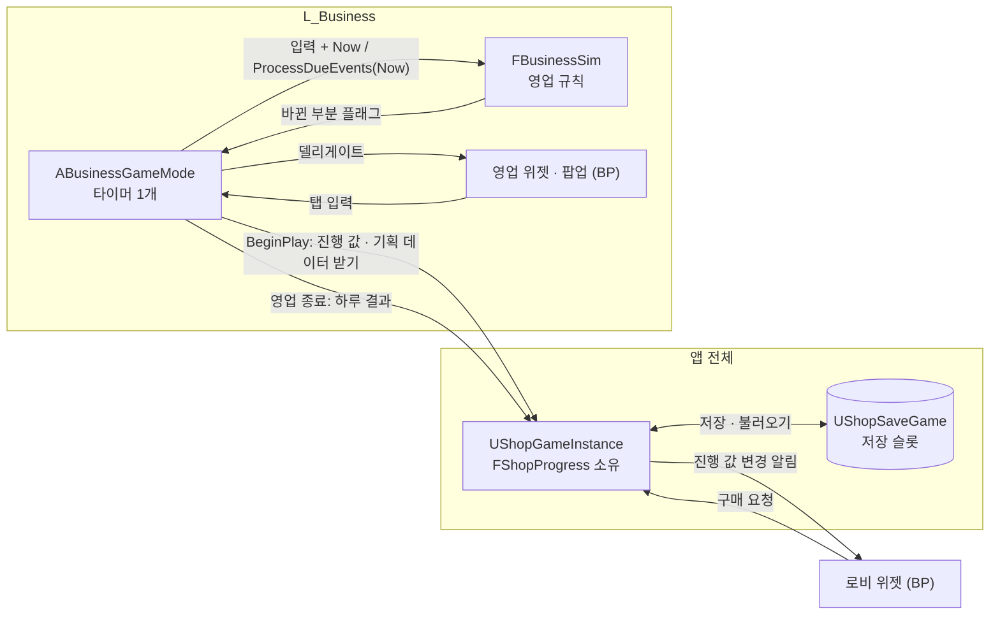
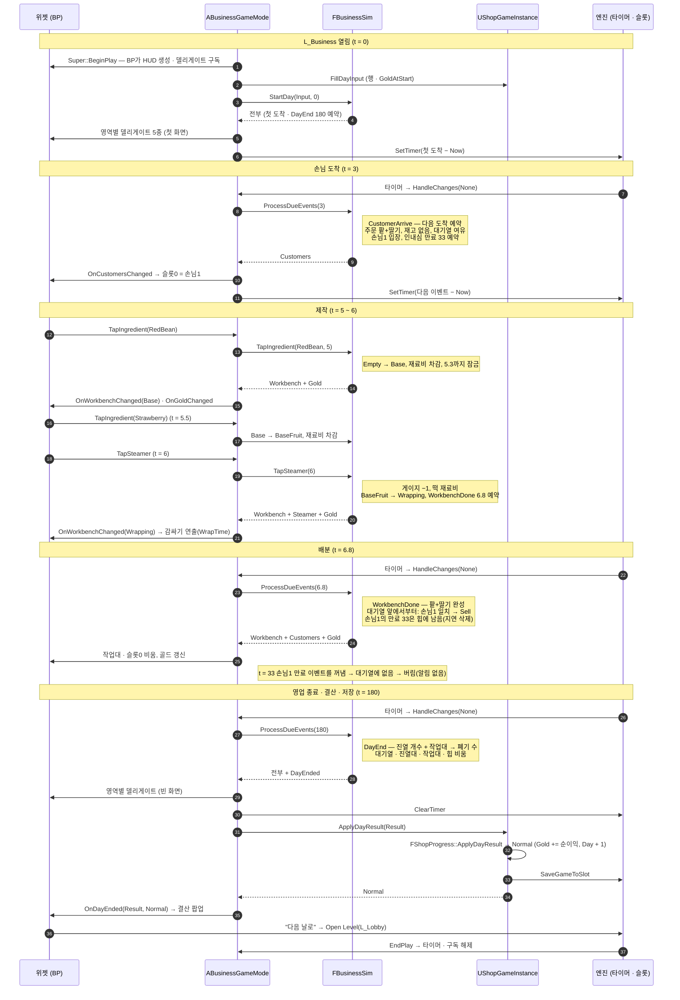
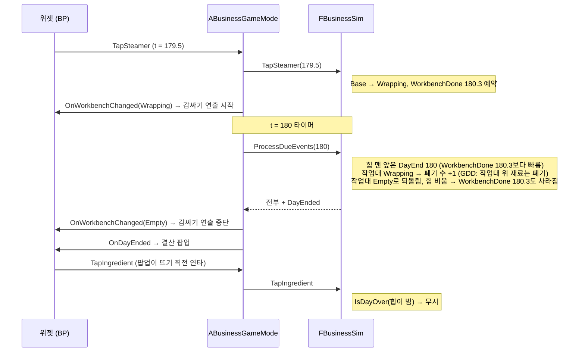
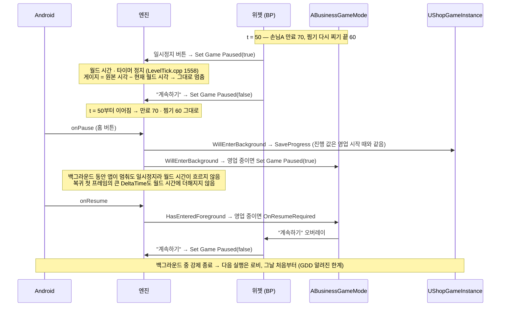
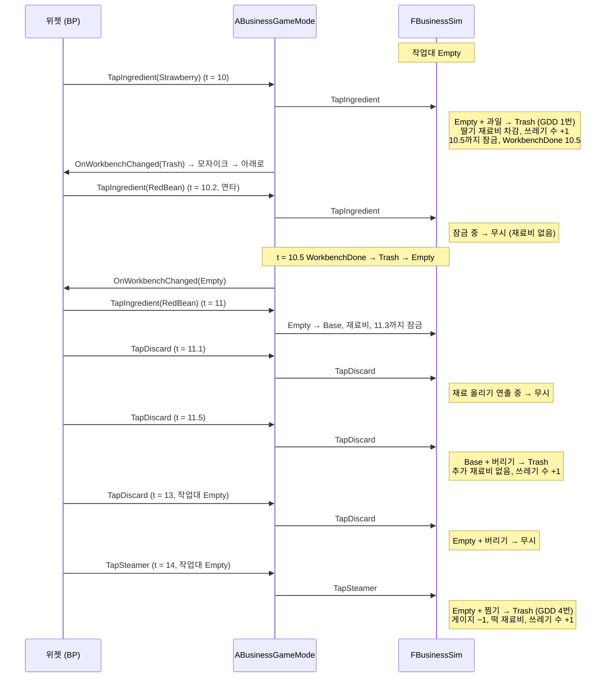
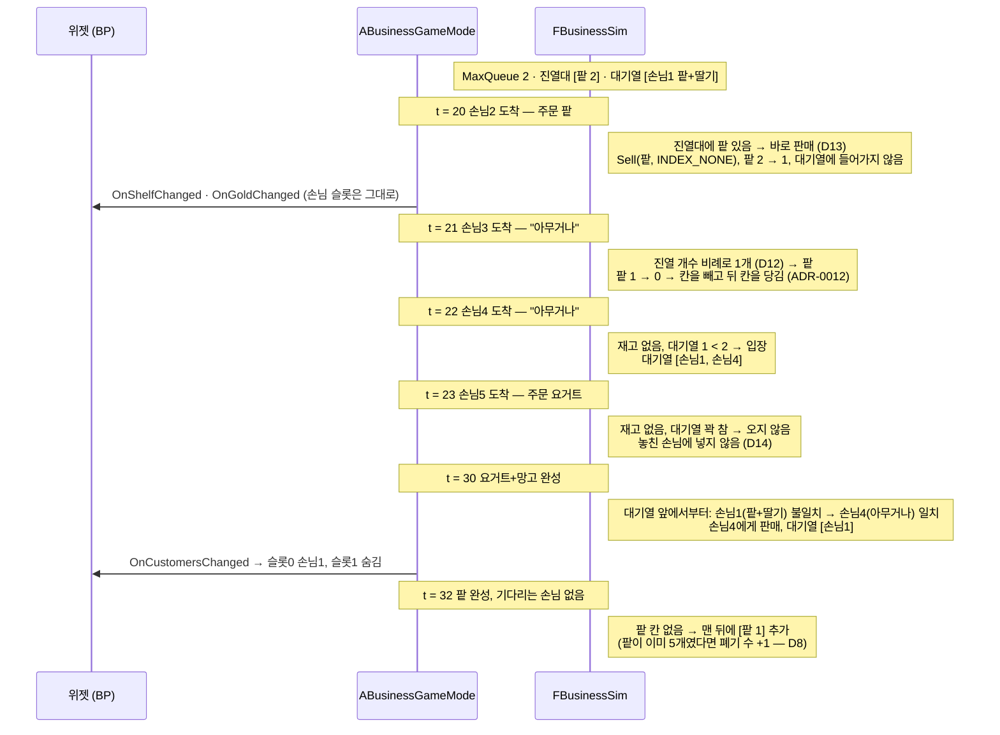
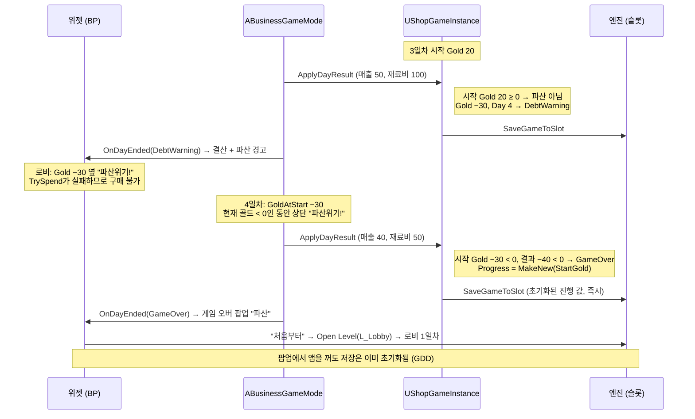

# AIGame — 설계 (Architecture)

> 진행 상태: 1~6단계 확정 · GDD v1.3 · CLAUDE.md · tasks.md 반영 완료 · 2026-11-19
> 표시: **[AI 판단]** AI가 정한 항목(이의가 있으면 확정 전에 지적) · **(결정 필요 Dn)** 사용자 결정 대기
> 확정된 설계 규칙은 CLAUDE.md "아키텍처 규칙" 절에 반영했다(이 세션에 한해 사용자가 파일 수정을 허락). 주요 결정은 adr/에 기록한다.
> 처음 보는 사람용 구조 요약: architecture-summary.html (전체 구조도: img/architecture-overview.png · .svg)

## 0. 최종 요약
| 항목 | 설계 | 근거 |
|---|---|---|
| 클래스 | `UShopGameInstance`(앱 전체 진행 · 저장 · 로비 구매 · 결산 적용) · `UShopSaveGame` · `ABusinessGameMode`(영업 레벨 구동 · 화면 중계) · `FBusinessSim`(영업 규칙, UObject 아님) + `FShopProgress`(진행 값 · 구매 · 결산 · 파산 규칙) | 1.2, ADR-0008 |
| 게임 개념 | 손님 · 모찌 조합 · 작업대 · 찜기 · 진열대는 클래스가 아니라 데이터(USTRUCT · enum · 멤버). 그림은 위젯이 데이터를 읽어 그린다 | 1.2.1, 1.10, ADR-0009 |
| 레벨 · 수명 | L_Lobby · L_Business. 진행 값은 GameInstance, 영업 상태는 영업 레벨과 함께 사라진다 | 1.1, ADR-0005 |
| 상태 소유 | 진행 값은 `FShopProgress` 한 곳, 영업 중에는 바뀌지 않고 결산 때 한 번 갱신. 영업 상태는 `FBusinessSim` | 1.3 |
| 시간 | 월드 시간 하나. `FBusinessSim`은 시계를 읽지 않고 Now를 인자로 받는다. 시간 이벤트 5종을 최소 힙 하나에 넣고 타이머 1개로 다음 이벤트만 예약 | 1.5, ADR-0004 |
| 화면 연결 | 바뀐 부분 플래그 → 영역별 델리게이트 7개(GameMode) + 1개(GameInstance). 로직은 위젯을 모른다 | 3.7, 3.8 |
| 데이터 | 종류는 enum + switch, 수치는 Data/*.csv 4개 → DataTable. 이미지는 BP 기본값 | 2, data-schema.md, ADR-0013 · 0014 |
| 경제 · 파산 | 하루 임대료 = 기본 50 + 요거트 · 파인애플 · 두바이초코 해금 때 증가. 실수가 많은 플레이는 해금 직후 파산 위험 | 5, ADR-0016 · 0017 |
| 검증 | 자동화 테스트 33개(World 없음, Simple Automation Test) · 추적표 R1~R46 · T1~T4 빈칸 없음 · 엔진 API 31개 선언 확인 · 시나리오 6개 워크스루 · 밸런스 시뮬레이션 | 1.6, 3.9, 4, 추적표, ADR-0007 |
| 결정 | D1~D18 → ADR-0004~0017. 각 ADR의 '판단 이유' · '결정자'는 사용자가 쓴다 | 1.8 · 3.11 · 5 |
| 반영 | 태스크 20개(Must 20h) → docs/03_impl/tasks.md, GDD 수정 목록 20건 → GDD v1.3, 아키텍처 규칙 → CLAUDE.md (사용자 허락으로 이 세션에서 반영) | 6 |

## 1. 아키텍처 골격

### 1.1 레벨과 수명
| 범위 | 사는 것 | 끝나는 시점 |
|---|---|---|
| 앱 전체 | `UShopGameInstance` (+ 멤버 `FShopProgress`) | 앱 종료 |
| L_Lobby | 로비 위젯 (BP) | 레벨 이동 |
| L_Business | `ABusinessGameMode` (+ 멤버 `FBusinessSim`), 영업 위젯 · 결산 / 게임 오버 / 일시정지 팝업 (BP) | 레벨 이동 — 영업 상태가 통째로 사라진다 |

- 레벨 이동은 BP가 `UGameplayStatics::OpenLevel`로 한다. 로비 "영업 시작" → L_Business, 결산 "다음 날로" · 게임 오버 "처음부터" → L_Lobby. (ADR-0005)
- 영업 중 진행은 저장하지 않으므로(GDD 저장 절) 영업 상태가 레벨과 함께 사라져도 잃는 것이 없다.

### 1.2 클래스 목록
| 클래스 | 부모 / 종류 | 책임 (한 줄) | 수명 | 검증 |
|---|---|---|---|---|
| `UShopGameInstance` | UGameInstance | 앱 전체 진행 상태를 소유하고 저장 · 불러오기, 로비 구매, 하루 결과 적용을 한다 | 앱 전체 | PIE · 실기기 |
| `UShopSaveGame` | USaveGame | 저장 슬롯에 쓰는 SaveVersion과 진행 값을 담는다 | 저장 · 불러오기 순간 | PIE · 실기기 |
| `FShopProgress` | USTRUCT | 저장되는 진행 값(Day · Gold · UnlockStep · SteamerLevel)과 구매 · 결산 · 파산 규칙 | GameInstance · SaveGame의 멤버 | 자동화 (World 없음) |
| `ABusinessGameMode` | AGameModeBase | 영업 레벨에서 FBusinessSim을 월드 시간과 타이머 1개로 구동하고 화면 입력 · 알림을 중계한다 | L_Business | PIE · 실기기 |
| `FBusinessSim` | 일반 C++ 클래스 (UObject 아님) | 영업 하루의 규칙(손님 · 주문 · 인내심, 작업대 · 찜기, 배분 · 진열대, 집계)을 현재 시각을 인자로 받아 처리한다 | ABusinessGameMode의 멤버 | 자동화 (World 없음) |

- 클래스 생성 기준: 개수 상한은 두지 않는다(ADR-0008). CLAUDE.md 45행(이 목록에 없는 C++ 클래스는 만들지 않음), 단순성 원칙(57~68행), S 점검(71행), 76행(구현체가 하나뿐인 인터페이스 금지)을 따른다.
- 손님 · 모찌 조합 · 작업대 · 찜기 등 게임 개념은 클래스가 아니라 데이터로 표현한다 → 1.2.1
- BP · 에셋 (사람 작업): BP_ShopGameInstance(기획 데이터 연결, Project Settings의 Game Instance Class), BP_BusinessGameMode(영업 위젯 생성, L_Business World Settings), 로비용 GameMode BP(Default Pawn 없음), 위젯 5종(로비 · 영업 · 결산 · 게임 오버 · 일시정지)과 하위 위젯 2종(손님 슬롯 · 진열 칸)

#### 1.2.1 게임 개념 → 타입 (클래스로 만들지 않는 것)
원칙: 규칙(행동)은 상태를 가진 쪽 한 곳(`FBusinessSim` · `FShopProgress`)에 두고, 게임 개념은 그 안의 데이터(USTRUCT · enum · 멤버)로 표현한다. 손님 · 작업대 · 찜기는 `FBusinessSim`만 쓰므로 별도 클래스로 나누면 CLAUDE.md 64행(한 곳에서만 쓰는 헬퍼 · 매니저 클래스 금지)에 걸린다. 화면의 모습은 위젯(BP)이 데이터를 읽어 그린다.

| 개념 | 타입 · 위치 | 클래스로 만들지 않는 이유 |
|---|---|---|
| 손님 | USTRUCT(BlueprintType) `FCustomer` — ID · 주문 · 외형 번호 · 도착 시각 · 인내심 만료 시각. `FBusinessSim`의 도착 순 `TArray<FCustomer>`(최대 5). 화면은 위젯 슬롯 5개(1.10) | 규칙 쪽에는 위치 · 이동이 없다(고정 이미지). 손님의 일(도착 · 만료 · 구매)은 대기열 전체를 보는 규칙이라 대기열 소유자가 처리한다. 그림은 위젯이 그린다(ADR-0009) |
| 주문 · 완성품 (모찌 조합) | USTRUCT(BlueprintType) `FRecipe` — 베이스 1 + 과일(없음 포함). "아무거나" 주문은 `FCustomer`의 표시 값 | 값 2개짜리 값 타입. 15조합은 해금된 재료로 계산하고 따로 저장하지 않는다. 화면은 베이스 이미지 위에 과일 이미지를 겹친다(ADR-0010) |
| 재료 (베이스 · 과일) | UENUM `EIngredient` (+ None). 가격 등 수치는 데이터 행(2단계) | 종류가 고정 → enum + switch(CLAUDE.md 72행, case-04) |
| 재료통 | 타입 없음. 위젯 버튼 → `ABusinessGameMode`의 입력 함수(재료 enum 인자). 해금 여부는 `FShopProgress.UnlockStep`에서 계산 | 상태가 없는 입력 버튼이다(재료는 무한, 골드와 무관) |
| 작업대 | `FBusinessSim` 멤버: UENUM `EWorkbenchState` + 올려 둔 재료(`FRecipe`) + 입력 잠금 해제 시각. 전이는 static 함수(전이표) | 1개뿐이고 `FBusinessSim`만 쓴다 |
| 찜기 | `FBusinessSim` 멤버: 게이지(int32). 재생성 완료는 이벤트 힙의 이벤트 | 같음 |
| 진열대 | `FBusinessSim` 멤버: 진열 목록 — 처음 진열된 순서의 `FShelfEntry` 배열(최대 15칸). 조합당 상한 5(기획 수치) — 상한이 찬 조합이 또 완성되고 기다리는 손님이 없으면 폐기(ADR-0011) | 같음 |
| 진열 칸 | USTRUCT(BlueprintType) `FShelfEntry` — 조합(`FRecipe`) · 개수. 화면은 칸마다 제품 이미지 1장 + 개수 숫자(ADR-0012) | 위젯이 읽는 값 묶음 |
| 쓰레기 | 상태가 아니다 — 작업대 전이 결과 + 집계 카운트 | — |
| 시간 이벤트 | 일반 struct `FBusinessEvent` — 시각 · 순번 · 종류(UENUM `EBusinessEventType`) · 손님 ID(포인터가 아니라 ID — ADR-0009) | BP에 노출하지 않는 내부 데이터 |
| 하루 결과 | USTRUCT(BlueprintType) `FDayResult` — 매출 · 재료비 · 판매 수 · 놓친 손님 · 쓰레기 · 폐기 | 결산 팝업이 읽는 값 묶음 |
| 결산 판정 | UENUM `EDayOutcome` — 정상 / 빚 경고 / 파산 | — |
| 화면 알림 | 바뀐 부분 플래그(`EBusinessChange`) → 영역별 델리게이트 7개(3.7) | — |
| 기획 수치 | 데이터 행 구조체 (2단계) | — |

- `BlueprintType`은 위젯이 읽어야 하는 타입에만 붙인다(CLAUDE.md 74행 I). 필드 · enum 값은 3단계에서 확정한다.
- Actor나 UObject가 필요해지는 경우: 월드에 위치 · 렌더링 · 충돌이 있거나 엔진 생명주기에 묶여야 할 때. 이 게임에서는 레벨 진행(GameMode) · 앱 수명(GameInstance) · 저장(SaveGame)만 해당한다. 화면에 그리는 일은 위젯(UMG, BP)이 맡는다(1.10).

선택 이유 [AI 판단]
- 진행 상태 소유자를 GameInstanceSubsystem이 아닌 GameInstance 하위 클래스로 둔다: 기획 데이터 에셋 참조를 BP 기본값으로 넣을 수 있다. Subsystem에 에셋 참조를 넣으려면 설정 클래스(UDeveloperSettings)가 하나 더 필요하다.
- 영업 구동을 WorldSubsystem이 아닌 GameMode로 둔다: L_Business의 BeginPlay가 곧 영업 시작이다. WorldSubsystem은 L_Lobby에도 생성되어 "지금이 영업 레벨인가"를 따로 판별해야 한다.
- 영업 규칙을 UObject가 아닌 일반 클래스로 둔다: 테스트에서 World · GC 없이 지역 변수로 바로 만든다. GameMode의 값 멤버라 수명이 GameMode와 같다.

S 점검 (CLAUDE.md 71행)
- `ABusinessGameMode`: 책임의 여러 동작이 모두 "FBusinessSim을 엔진(시간 · 타이머 · 일시정지 · 생명주기)과 화면에 잇는다" 한 이유로 바뀌고 코드가 작아 합쳐 둔다.
- `FBusinessSim`: 손님 · 작업대 · 배분을 한 클래스에 둔다. 완성품 배분이 대기열과 진열대를 함께 바꾸고, 영업 종료가 모든 상태를 한 번에 정리한다. 나누면 서로의 상태를 넘겨받는 호출 단계만 늘어난다. 작업대 전이표는 클래스 안의 static 함수로 두어 표 그대로 테스트한다(3단계).

### 1.3 상태 소유자
| 상태 | 소유자 | 비고 |
|---|---|---|
| Day · Gold · UnlockStep · SteamerLevel | `FShopProgress` (GameInstance가 보유, SaveGame에 그대로 저장) | 영업 중에는 바뀌지 않는다. 결산 때 한 번 갱신 |
| 영업 중 매출 합계 · 재료비 합계 · 임대료 | `FBusinessSim` | 화면의 현재 골드 = 영업 시작 골드(하루 입력) − 임대료 + 매출 − 재료비. 따로 저장하지 않고 계산한다(CLAUDE.md 65행). 결산 뒤 Progress.Gold가 바뀌어도 값이 흔들리지 않도록 Progress를 다시 읽지 않는다 |
| 손님 대기열(도착 순, 최대 5) · 주문 · 외형 번호 · 인내심 만료 시각 | `FBusinessSim` | 외형 번호는 도착 때 정해 떠날 때까지 유지 |
| 시간 이벤트 힙 | `FBusinessSim` | 1.5 |
| 작업대 상태 · 입력 잠금 해제 시각 | `FBusinessSim` | |
| 찜기 게이지 · 재생성 완료 시각 | `FBusinessSim` | |
| 진열대 재고 (처음 진열된 순서의 조합 · 개수 목록) | `FBusinessSim` | 개수가 0이 되면 칸을 빼고 뒤 칸이 앞으로 당겨진다. 다시 만들면 맨 뒤에 붙는다(GDD "재고가 있는 조합만 칸") |
| 하루 집계 (판매 수 · 놓친 손님 · 쓰레기 · 폐기) | `FBusinessSim` → 영업 종료 때 결과로 넘김 | |
| 타이머 핸들 1개 | `ABusinessGameMode` | |
| 일시정지 여부 | 엔진 (`UGameplayStatics::SetGamePaused` / `IsGamePaused`) | bool을 따로 두지 않는다 [AI 판단] |
| 게이지 보간 등 연출 값 | 위젯 (BP) | CLAUDE.md 50행 |

### 1.4 데이터 흐름


1. 앱 시작: GameInstance가 슬롯을 불러온다. 없으면 GDD 시작 조건 값으로 시작한다.
2. 로비: 위젯이 GameInstance의 구매 함수를 부르고, 성공하면 저장한 뒤 변경을 알린다.
3. 영업 시작: BP가 L_Business을 연다 → ABusinessGameMode BeginPlay가 GameInstance에서 진행 값 · 기획 데이터를 받아 `FBusinessSim`의 하루를 시작한다.
4. 영업 중: 위젯의 탭은 ABusinessGameMode의 입력 함수로 들어가 Now와 함께 `FBusinessSim`에 전달된다. 타이머가 울리면 `ProcessDueEvents(Now)`를 부른다. 두 경우 모두 `FBusinessSim`이 이번 호출로 바뀐 부분을 플래그(`EBusinessChange`, 3.6)로 돌려주고, ABusinessGameMode가 그 영역의 델리게이트로 위젯에 알린 뒤 타이머를 다시 건다.
5. 영업 종료: 영업 종료 이벤트에서 ABusinessGameMode가 하루 결과를 GameInstance에 넘긴다 → `FShopProgress`가 골드 · 일차를 갱신하고 파산을 판정한다 → 저장(게임 오버면 저장 초기화) → 결산 또는 게임 오버 팝업.
- 로직은 위젯을 모른다. 위젯은 ABusinessGameMode · GameInstance의 BP 노출 함수와 델리게이트만 쓴다(CLAUDE.md 46 · 75행).

### 1.5 시간 기준
- 시간 원본은 `UWorld::GetTimeSeconds()`(double) 하나다. 게임 일시정지 중에는 월드 타이머도 멈춘다: `Runtime/Engine/Private/LevelTick.cpp` 1558행 — 일시정지면 `GetTimerManager().Tick`을 부르지 않는다. (ADR-0001의 PIE 확인 항목은 그대로 유지)
- `FBusinessSim`은 시계를 읽지 않는다. 모든 함수가 `double Now`를 인자로 받는다. 운영에서는 ABusinessGameMode가 `GetTimeSeconds()`를 넣고, 테스트는 원하는 시각을 직접 넣는다. (ADR-0004)
- 시간 이벤트 5종(손님 도착 · 손님 인내심 만료 · 찜기 재생성 완료 · 작업대 연출 끝 · 영업 종료)을 모두 하나의 만료 시각 최소 힙(`TArray::HeapPush` / `HeapPop` + 시각 비교 술어, `Runtime/Core/Public/Containers/Array.h`)에 넣는다(D1). ABusinessGameMode는 `FTimerHandle` 하나를 "힙 맨 앞 시각 − Now" 뒤로 건다.
- 같은 시각의 이벤트는 넣은 순서대로 처리한다. TArray 힙은 같은 키의 순서를 보장하지 않으므로, 이벤트에 증가하는 순번을 두고 술어가 (시각, 순번) 순으로 비교한다. 순번 변수는 '정확성: 처리 순서를 테스트로 재현' 때문에 둔다.
- 구매로 먼저 떠난 손님의 만료 이벤트는 힙에 남겨 두고, 꺼낼 때 그 손님이 아직 대기 중인지 손님 ID로 확인해 아니면 버린다(지연 삭제, D2). 영업 종료 때 힙을 통째로 비운다.
- `ProcessDueEvents(Now)`는 Now 이하인 이벤트를 모두 꺼내 처리하므로, 다시 거는 간격은 항상 0보다 크다. 간격이 0 이하면 타이머가 등록되지 않는다(`Runtime/Engine/Private/TimerManager.cpp` 595행 `if (InRate > 0.f)`).
- 입력 처리로 새 이벤트가 생기면(예: 찜기 탭 → 감싸기 끝 시각) 입력 처리 뒤에도 타이머를 다시 건다.
- 화면의 남은 시간 · 인내심 게이지는 위젯이 "원본 시각 − 현재 월드 시각"으로 계산한다(CLAUDE.md 51행). 원본 시각은 BP 노출 조회 함수로 읽는다.
- 힙 크기 n (ADR-0003 요구): 대기 손님 수(MaxQueue 이하) + 지연 삭제로 남은 원소(하루 손님 수 이하) + 손님 외 이벤트(종류별 최대 1개, 4개). MaxQueue는 화면 슬롯 수인 5 이하다(data-schema.md, 5단계 초안 3~5) → n은 수십 이하. TArray 힙 함수를 쓰면 코드 양이 선형 탐색(Add + 최소값 탐색)과 비슷하므로, 코드를 늘리지 않고 O(n) → O(log n)을 얻는다.

### 1.6 테스트 경계
| 대상 | 방법 | 단순성 원칙 분류 |
|---|---|---|
| `FBusinessSim` — 손님 · 인내심 · 배분 · 작업대 전이표 · 찜기 · 영업 종료 | 자동화 테스트, World 없음. Now를 직접 넣고, 데이터는 행 구조체를 코드에서 만들어 넣는다(DataTable 에셋을 읽지 않음) | 정확성: GDD 리스크 2, 기술 포인트 2(전이표 테스트), 기술 포인트 3(시드 고정 재현) |
| `FShopProgress` — 해금 · 업그레이드 가능 여부, 결산 적용, 파산 판정 | 자동화 테스트, World 없음 | 정확성: GDD 빚과 파산 규칙 |
| `UShopGameInstance` — 슬롯 저장 · 불러오기 · 초기화, 백그라운드 저장 | PIE · 실기기 (파일 I/O · 앱 생명주기) | — |
| `ABusinessGameMode` — 타이머 · 일시정지 · 델리게이트 연결 | PIE · 실기기 | — |
| 위젯 | PIE · 실기기 (사람) | — |

- 테스트 방식(D4 · ADR-0007): `IMPLEMENT_SIMPLE_AUTOMATION_TEST`(`Runtime/Core/Public/Misc/AutomationTest.h`). 테스트 하나 = 함수 하나. 위치 `Source/AIGame/Private/Tests/`, `#if WITH_DEV_AUTOMATION_TESTS`로 감싼다(UBT가 정의 — `Programs/UnrealBuildTool/Configuration/UEBuildTarget.cs` 5372행, Shipping 제외). 플래그는 `EditorContext | ProductFilter`(필터는 정확히 1개 — `AutomationTest.h` 3988행 static_assert). 테스트 이름은 `AIGame.<대상>.<규칙>`. 반복되는 준비 코드는 테스트 파일 안의 도우미 함수 하나로 모은다. 실행: 에디터 Session Frontend → Automation 탭
- 무작위: `FBusinessSim`이 `FRandomStream`(`Runtime/Core/Public/Math/RandomStream.h`)을 멤버로 갖고 하루 시작 때 시드를 받는다. 테스트는 고정 시드, 게임은 매번 다른 시드 [AI 판단].

### 1.7 모바일 생명주기
- Android에서 앱이 내려갈 때 `ApplicationWillDeactivateDelegate`와 `ApplicationWillEnterBackgroundDelegate`가 연달아 브로드캐스트되고(`Runtime/Launch/Private/Android/LaunchAndroid.cpp` 1514~1515행), 돌아올 때 `ApplicationHasEnteredForegroundDelegate`와 `ApplicationHasReactivatedDelegate`가 연달아 온다(1455~1456행). 둘 다 구독하면 두 번 처리되므로 한 쌍(WillEnterBackground / HasEnteredForeground)만 구독한다. [AI 판단]
- `UShopGameInstance`: 백그라운드 진입 때 진행 값을 저장한다. 영업 중에도 진행 값은 영업 시작 때와 같으므로, 레벨을 구분하지 않고 저장해도 결과가 GDD("로비 상태에서 저장")와 같다. 레벨 구분용 상태를 두지 않기 위함이다. [AI 판단]
- `ABusinessGameMode`: 백그라운드 진입 때 게임을 일시정지한다. 복귀 때는 일시정지를 유지한 채 "계속하기" 오버레이를 띄우라고 델리게이트로 알린다. 둘 다 영업 중일 때만 한다 — 결산 · 게임 오버 팝업 위에는 띄우지 않는다(4.7 F2).

### 1.8 1단계 결정 (2026-11-19)
| ID | 결정 | 기록 |
|---|---|---|
| D1 | A — 시간 이벤트 5종을 모두 같은 힙에 | ADR-0004 |
| D2 | A — 지연 삭제 | ADR-0004 |
| D3 | A — 도착 순 대기열 선형 탐색 (조합별 큐 없음) | ADR-0006 |
| D4 | A — Simple Automation Test | ADR-0007 |
| D5 | 손님은 위젯 슬롯 5개가 대기열 데이터를 그린다. 힙에는 손님 ID | ADR-0009 |
| D6 | 손님 외형은 도착 때 무작위(시드 고정 난수), `FCustomer`에 외형 번호 | ADR-0009 |
| D7 | 제품 이미지는 베이스 + 과일 이미지 겹치기 | ADR-0010 |
| D8 | 진열대 조합당 상한 5. 찬 조합이 또 완성되고 기다리는 손님이 없으면 폐기 | ADR-0011 |
| D9 | 진열대는 조합당 칸 1개(제품 이미지 + 개수 점), 2행 × 8열(2026-11-22 보완), 처음 진열된 순서로 한 행씩 채움, 행 위치는 행 수에 따라 균등 | ADR-0012 |
| D10 | (2단계) 종류는 enum + switch, 수치는 CSV → DataTable | ADR-0013 |
| D11 | (2단계) 이미지 에셋 참조는 BP 기본값. 손님 외형 수는 그 배열 길이 | ADR-0014 |
| D12~D15 | (3단계) GDD에 없던 규칙 4건 — 3.11 | ADR-0015 |
| D16 | (5단계) 하루 고정 임대료 추가. 파산은 뒤 재료일수록 가파른 재료비로 — D18로 대체됨 | ADR-0016 |
| D17 | (5단계) 임대료는 영업 시작 때 낸다(현재 골드에 바로 반영). 파산 판정은 결산 때만 | ADR-0016 |
| D18 | (5단계 재검토) 뒤 재료는 판매가도 올린다. 임대료 = 기본 + 요거트 · 파인애플 · 두바이초코 해금 때마다 증가(Ingredients.RentIncrease) | ADR-0017 |

아래는 D1~D4 결정 당시의 선택지 기록이다. D5~D9의 선택지는 각 ADR에 있다.

**D1. 손님 인내심 외의 시간 이벤트(손님 도착 간격, 찜기 재생성, 작업대 연출 잠금, 영업 종료)를 어디에 둘까**
- A (추천): 같은 힙에 모두 넣는다. 이벤트 종류 enum 1개 + switch로 처리한다.
  - 장점: 시간 원본 · 타이머가 하나라 모든 시간 규칙(GDD 리스크 2의 '연출 도중 영업 종료', '일시정지 중 타이머')을 World 없이 테스트한다. 같은 시각 이벤트는 넣은 순서로 처리해 순서가 정해진다.
  - 단점: CLAUDE.md 67행(FTimerManager 재구현 금지)과 경계에 있다. 힙이 FTimerManager의 일(시각순 호출)을 일부 대신한다.
- B: 손님 인내심만 힙, 나머지 4개는 각자 FTimerHandle.
  - 장점: 엔진 기능을 그대로 쓴다.
  - 단점: 그 4개 경로는 World가 있어야 테스트할 수 있다. 핸들 4개와 일시정지 · 영업 종료 때 정리 코드가 늘고, 같은 프레임의 처리 순서는 엔진 내부 순서에 맡겨진다.

**D2. 손님이 만료 전에 빠질 때(구매로 떠남) 힙 원소 처리**
- A (추천): 지연 삭제. 힙에서 꺼낼 때 그 손님이 아직 대기 중인지 손님 ID로 확인하고, 아니면 버린다. 버려질 원소 수는 하루 손님 수 이하. 추가 코드는 꺼낼 때 if 하나.
- B: 즉시 삭제. 힙에서 해당 원소를 찾아(O(n)) `HeapRemoveAt`(O(log n)). 찾는 코드가 추가된다.
- 영업 종료 때는 두 안 모두 힙을 통째로 비운다.

**D3. 완성품 배분: GDD 기술 포인트 3(조합별 대기 큐 + "아무거나" 큐, 맨 앞끼리 비교 O(1))을 유지할까**
- A (추천): 큐를 따로 두지 않는다. 도착 순 대기열 하나를 앞에서부터 훑어 '그 조합을 주문했거나 아무거나'인 첫 손님에게 준다. O(n), n = 대기 손님 수(MaxQueue 이하, 한 자릿수).
- B: GDD대로 조합별 큐 16개(15조합 + 아무거나)를 유지한다.
  - B의 단점: 손님이 인내심으로 떠날 때 대기열과 조합별 큐 두 곳에서 지워야 한다. 같은 정보를 두 곳에 저장하고(CLAUDE.md 65행), 큐 중간 삭제라 O(k)가 된다. n이 한 자릿수라 측정할 수 있는 이득이 없다(ADR-0003: 성능 근거는 n 크기와 함께 판단).
- A로 정하면 GDD 기술 포인트 3 문구 수정이 필요하다 → GDD 수정 목록.

**D4. 자동화 테스트 방식**
- A (추천): `IMPLEMENT_SIMPLE_AUTOMATION_TEST`(`Runtime/Core/Public/Misc/AutomationTest.h`). 테스트 하나 = 함수 하나. 전이표 같은 표 기반 테스트는 반복문으로 충분하다. 위치는 `Source/AIGame/Private/Tests/`, `WITH_DEV_AUTOMATION_TESTS`로 감싸 Shipping에서 빠진다. 실행은 에디터 Session Frontend의 Automation 탭.
- B: Automation Spec(`BEGIN_DEFINE_SPEC`). Describe / It으로 시나리오를 묶기 좋지만 매크로와 익힐 것이 더 많다.

### 1.9 생략하거나 미룬 것
- 함수 · 델리게이트 시그니처, enum 값 → 3단계
- 기획 데이터 원본(DataTable 여부)과 GameInstance가 데이터를 들고 있는 방식 → 2단계
- GDD에 없는 규칙 (3 · 4단계에서 질문 예정): "아무거나" 손님이 재고에서 무작위로 고르는 기준(개수 비례 / 조합 균등), 대기열이 꽉 차서 오지 않은 손님을 '놓친 손님 수'에 넣는지, 감싸기 도중 영업이 끝날 때 그 모찌를 폐기로 셀지

### 1.10 화면 표시 구조 (D5~D9)
- 원칙: 규칙(C++)은 "무엇이 있는가"만 갖고, 그림은 위젯(BP)이 데이터를 읽어 그린다. 로직은 위젯 · 오브젝트 포인터를 갖지 않는다(CLAUDE.md 75행, ADR-0009).
- 손님 줄: 영업 위젯 안에 `WBP_CustomerSlot` 5개를 가로로 둔다. HUD가 생길 때 한 번 만들고 재사용한다(생성 · 파괴 없음). 손님 변경 알림 때 슬롯 i ← `WaitingCustomers[i]`, 남는 슬롯은 숨긴다. 앞사람이 떠나면 뒷사람이 한 칸씩 앞으로 당겨진다 [AI 판단].
  - 슬롯 구성: 사람 이미지(외형 번호로 선택) + 머리 위 말풍선(베이스 아이콘 + 과일 아이콘, 또는 "아무거나" 아이콘) + 인내심 게이지("만료 시각 − 현재 월드 시각")
  - 외형: 도착 때 `FRandomStream`으로 0 ~ (외형 수 − 1) 중 하나를 고른다. 외형 수는 BP에서 채운 사람 이미지 배열의 길이다(ADR-0014). 데이터에 따로 두지 않는다.
  - 화면 슬롯이 5개이므로 MaxQueue(일차별 수치)는 5 이하
- 진열대 (ADR-0012, 2026-11-22 보완): 2행 × 8열 = 16칸. 조합 최대 15종이 모두 들어간다.
  - 칸 하나 = 조합 하나: 제품 이미지 1장 + 그 아래 진열 개수 점(점 수 = `MaxStockPerRecipe`, 진열 개수만큼 채움). 위젯 칸 15개를 미리 두고 칸 i ← 진열 목록 i번째, 남는 칸은 숨긴다.
  - 제품 이미지: 베이스 이미지 위에 과일 이미지를 겹친다(과일 없음이면 베이스만). 같은 재료 이미지는 모든 제품이 같은 텍스처 에셋을 공유한다(플라이웨이트, ADR-0010).
  - 채우는 순서: 처음 진열된 순서대로 한 행(8칸)을 채운 뒤 다음 행으로 넘어간다. 행 안에서는 순서대로 왼쪽 → 오른쪽이고, 행마다 가운데 정렬한다(칸이 늘면 앞 칸이 왼쪽으로 밀린다, 2026-11-22 보완: docs/02_design/art-style.md 1.1). 이 가로 배치도 위젯(BP) 연출이다. 개수가 0이 되면 그 칸을 빼고 뒤 칸이 앞으로 당겨진다. 다시 만들어지면 맨 뒤에 붙는다.
  - 행 위치: 행 수 n = ⌈칸 수 / 8⌉ (≤ 2). k번째 행(1부터)의 세로 중심 = 진열대 높이 × k / (n + 1).
    - 1행: 0.5(중앙) · 2행: 0.33, 0.67
    - 행 수가 바뀔 때(칸 수가 8을 넘거나 그 아래로 내려갈 때)만 다시 계산한다. 이 배치 계산은 위젯(BP) 연출이다.
- 완성품 배분 순서: ① 그 조합 또는 "아무거나"를 주문한 가장 먼저 온 손님(ADR-0006) ② 그 조합 재고가 상한 미만이면 진열대 ③ 아니면 폐기(재료비는 이미 차감됨, 결산 폐기 수 +1)(ADR-0011)
- 이미지 에셋 참조는 BP 기본값에 둔다(ADR-0014, data-schema.md 'CSV 밖에 두는 것').

## 2. 데이터 (2단계)

### 2.1 데이터 원본 비교 (D10 결정: A — ADR-0013)
- A. 현재 CLAUDE.md 방식(case-04에서 사용자가 정정한 안): 종류(재료 · 작업대 상태 등)는 enum + switch, 수치는 Data/*.csv → DataTable `FindRow`
- B. 수치까지 C++ switch: 재료 · 일차 · 찜기 레벨별 수치를 switch로 돌려준다. 코드가 원본

| 비교 축 | A. enum + DataTable | B. 수치까지 switch |
|---|---|---|
| 구현 시간 | Row 구조체 4개 + CSV 4개 + DataTable 에셋 4개(가져오기는 사람) + 조회 코드. B보다 1시간 안팎 더 든다 | 수치마다 switch 함수. 일차표는 일차 번호 switch + "마지막 행 반복" 처리 |
| 자동화 테스트에서 수치 넣기 | 테스트가 Row 구조체를 코드에서 직접 만들어 넣는다 → 밸런스를 바꿔도 테스트가 깨지지 않는다 | 수치가 컴파일 상수라 테스트가 실제 밸런스 값에 묶인다. 밸런스를 바꿀 때마다 기대값을 고치거나, 값을 넣는 통로를 따로 만들어야 한다(= A의 Row 구조체를 다시 만드는 셈) |
| 밸런스 수정이 게임에 반영되는 경로 | CSV 수정 → 에디터에서 DataTable 재가져오기(사람) → PIE | .cpp 수정 → 빌드(Build.bat 또는 Live Coding) → PIE |
| AI가 읽기 · git diff 추적 | CSV가 원본 텍스트라 읽히고 diff로 추적된다(DataTable .uasset은 바이너리지만 CSV와 같은 내용) | 코드 diff로 추적된다 |
| 화면 표시 이름 · 아이콘 | 이름(FText)을 CSV 열로 둘 수 있다(CLAUDE.md 80행 충족) | 한국어 이름을 C++에 쓸 수 없어(80행) BP나 CSV가 따로 필요하다 → 원본이 둘로 나뉜다 |
| GDD 기술 포인트 4 (재료 한 줄 추가로 조합 자동 생성) | 재료 추가 = enum 값 1개 + CSV 행 1개. 조합은 해금된 재료로 자동 계산 | 재료 추가 = enum 값 1개 + 수치 switch 함수마다 case 추가 |
| Android 패키징 | DataTable 에셋이 쿡(cook)에 포함돼야 한다. GameInstance BP가 직접 참조하면 함께 포함된다 → 첫 APK에서 확인 | 영향 없음 |
| CLAUDE.md | 52 · 72 · 90행과 일치 | 52 · 72 · 90행 수정 필요. case-04에서 사용자가 기각한 해석("수치 전체를 코드로")과 같다 |

- AI 추천: A. 결정적인 차이는 테스트 축이다 — B에서는 밸런스 조정(GDD 리스크 4)이 테스트 기대값을 깨뜨려, 테스트로 규칙을 고정하는 목적(리스크 2)과 부딪힌다.
- 두 안 모두 GDD 기술 포인트 4의 "재료 표 한 줄 추가로"는 사실과 다르다. 재료 종류가 enum(코드)이기 때문이다 → 결정 후 GDD 수정 목록에 넣는다.

### 2.2 함께 정할 것 (case-04 후속 · 1단계에서 넘어온 것)
| 항목 | 제안 | 근거 |
|---|---|---|
| Base / Fruit 구분의 원본 | 코드: `EIngredient` switch. CSV에 Type 열을 두지 않는다 | 재료 종류는 고정(case-04). 두 곳에 두면 어긋날 수 있다(CLAUDE.md 65행) [AI 판단] |
| 해금 순서의 원본 | CSV: Ingredients의 UnlockOrder 열 | 순서 조정은 밸런스 작업이다(52행) [AI 판단] |
| enum ↔ DataTable 행 연결 | 행 이름 = enum 값 이름(예: Strawberry). `UEnum::GetNameStringByValue`(`Runtime/CoreUObject/Public/UObject/Class.h` 2221행)로 행 이름을 만든다. 반환 형식(접두사 유무)은 구현 때 테스트로 확인 | 문자열 키를 코드에 쓰지 않는다 [AI 판단] |
| 이미지 에셋(재료 아이콘 · 제품 겹침 이미지 · 사람 외형) 참조 위치 | D11 결정: BP 기본값. 외형 수 = 그 배열 길이 | ADR-0014 |
| Balance 형식 | 한 행에 상수마다 열(행 이름 `Default`) | 필드 이름이 컴파일 때 확인되고 코드에 문자열 키가 없다 [AI 판단] |

### 2.3 스키마
- 표 4개(Ingredients · Days · Steamer · Balance)의 컬럼 · 타입 · 키 · 제약: **data-schema.md**
- 기획 데이터 DataTable 4개는 `UShopGameInstance`가 참조한다(BP_ShopGameInstance에서 지정). `ABusinessGameMode`는 하루 시작 때 GameInstance에서 필요한 행을 받아 `FBusinessSim`에 Row 구조체로 넘긴다(1.4).

### 2.4 생략하거나 미룬 것
- 수치 값 → 5단계
- 데이터 검증 실패 처리(check / 로그), 이미지 프로퍼티의 소유 클래스 → 3단계

## 3. 클래스 상세 (3단계)
> 헤더 선언만 쓴다. 함수 본문은 쓰지 않고, 본문이 한 줄인 접근자만 헤더에 정의한다(CLAUDE.md 87행). 주석은 CLAUDE.md 주석 규칙을 따른다(UCLASS · USTRUCT 위 책임 한 줄, public 함수 · 델리게이트 위 `/** */` 계약). Source/는 수정하지 않았다 — 구현 때 이 블록을 기준으로 만든다.
> 1단계에서 바뀐 것 [AI 판단]: `FBusinessSim`이 돌려주는 값을 '이벤트 목록'에서 '바뀐 부분 플래그(`EBusinessChange`)'로 단순화했다. 위젯은 영역별 델리게이트를 받은 뒤 조회 함수로 다시 그리므로, 무슨 일이 있었는지의 목록까지는 필요 없다.

### 3.1 파일
| 파일 (`Source/AIGame/`) | 내용 |
|---|---|
| `AIGame.h` · `AIGame.cpp` | `LogAIGame` 로그 카테고리 선언 · 정의 — 지금은 없다(CLAUDE.md 94행) |
| `Shop/ShopTypes.h` · `Shop/ShopTypes.cpp` | 공용 enum · 구조체 · 데이터 행, `IsBaseIngredient` |
| `Shop/ShopProgress.h` · `Shop/ShopProgress.cpp` | `FShopProgress` |
| `Shop/ShopSaveGame.h` | `UShopSaveGame` |
| `Shop/ShopGameInstance.h` · `Shop/ShopGameInstance.cpp` | `UShopGameInstance` |
| `Business/BusinessSim.h` · `Business/BusinessSim.cpp` | `FBusinessSim`과 내부 타입(UHT 대상 아님) |
| `Business/BusinessGameMode.h` · `Business/BusinessGameMode.cpp` | `ABusinessGameMode` |
| `Private/Tests/BusinessSimTests.cpp` · `Private/Tests/ShopProgressTests.cpp` | 자동화 테스트(ADR-0007) |
- Shop으로 시작하는 파일은 `Shop/`, Business로 시작하는 파일은 `Business/`에 둔다. 모듈 파일(`AIGame.*` · Build.cs)과 `Private/Tests`는 모듈 폴더에 그대로 둔다 (사용자 결정, T08 뒤 폴더 정리).
- Build.cs: 추가 모듈 없음. 쓰는 기능(DataTable · GameplayStatics · SaveGame · TimerManager · Texture2D)이 모두 `Engine` 모듈이다.
- Build.cs: `PrivateIncludePaths.Add(ModuleDirectory)` (T02 사용자 결정). 폴더를 넘는 include는 모듈 루트 기준 경로(`"Shop/ShopProgress.h"`)로 쓰고, 같은 폴더끼리는 이름만 쓴다. `BuildSettingsVersion.V5`에서는 모듈 루트가 기본 탐색 경로에 없다(UBT `ModuleRules.cs` 1418행 · `UEBuildModuleCPP.cs` 259행). `"AIGame/ShopProgress.h"`(UBT가 넣는 `Source` 경로)는 경로인지 모듈 이름인지 헷갈려서 쓰지 않는다.

### 3.2 공용 타입 — ShopTypes.h
```cpp
#pragma once

#include "CoreMinimal.h"
#include "Engine/DataTable.h"
#include "Misc/EnumRange.h"
#include "ShopTypes.generated.h"

/** 재료 종류. 고정 집합이라 종류별 분기는 switch로 쓴다. DataTable 행 이름 = 값 이름 */
UENUM(BlueprintType)
enum class EIngredient : uint8
{
	None,
	RedBean,
	Yogurt,
	DubaiChoco,
	Strawberry,
	Blueberry,
	Pineapple,
	Mango
};
ENUM_RANGE_BY_FIRST_AND_LAST(EIngredient, EIngredient::RedBean, EIngredient::Mango);

/** 베이스면 true, 과일이면 false. None은 checkNoEntry() */
bool IsBaseIngredient(EIngredient Ingredient);

/** 작업대 상태 (GDD 제작 상태도) */
UENUM(BlueprintType)
enum class EWorkbenchState : uint8
{
	Empty,
	Base,
	BaseFruit,
	Wrapping,
	Trash
};

/** 하루 결산 판정 */
UENUM(BlueprintType)
enum class EDayOutcome : uint8
{
	Normal,
	DebtWarning,
	GameOver
};

/** 모찌 조합 = 베이스 1 + 과일 0~1. 주문과 완성품이 같은 형태다 */
USTRUCT(BlueprintType)
struct FRecipe
{
	GENERATED_BODY()

	UPROPERTY(BlueprintReadOnly)
	EIngredient Base = EIngredient::None;

	/** None이면 과일 없음 */
	UPROPERTY(BlueprintReadOnly)
	EIngredient Fruit = EIngredient::None;

	bool operator==(const FRecipe& Other) const { return Base == Other.Base && Fruit == Other.Fruit; }
};

/** 대기 중인 손님 한 명 */
USTRUCT(BlueprintType)
struct FCustomer
{
	GENERATED_BODY()

	/** 1부터 하루 동안 증가. 힙 이벤트가 이 값으로 손님을 찾는다(ADR-0009) */
	UPROPERTY(BlueprintReadOnly)
	int32 Id = 0;

	/** bAnyOrder면 쓰지 않는다 */
	UPROPERTY(BlueprintReadOnly)
	FRecipe Order;

	UPROPERTY(BlueprintReadOnly)
	bool bAnyOrder = false;

	/** 사람 외형 이미지 배열(ABusinessGameMode의 CustomerLookImages) 인덱스 */
	UPROPERTY(BlueprintReadOnly)
	int32 LookIndex = 0;

	/** 인내심 만료 시각(월드 시간). 게이지 = (ExpireTime − 현재 월드 시각) / Patience */
	UPROPERTY(BlueprintReadOnly)
	double ExpireTime = 0.0;
};

/** 진열대 칸 하나 = 조합 하나 */
USTRUCT(BlueprintType)
struct FShelfEntry
{
	GENERATED_BODY()

	UPROPERTY(BlueprintReadOnly)
	FRecipe Recipe;

	/** 1 ~ MaxStockPerRecipe */
	UPROPERTY(BlueprintReadOnly)
	int32 Count = 0;
};

/** 하루 집계. 영업 중에는 누적값, 영업 종료 때 결산 결과. 순이익 = Sales − IngredientCost − Rent(따로 두지 않는다) */
USTRUCT(BlueprintType)
struct FDayResult
{
	GENERATED_BODY()

	UPROPERTY(BlueprintReadOnly)
	int32 Sales = 0;

	UPROPERTY(BlueprintReadOnly)
	int32 IngredientCost = 0;

	UPROPERTY(BlueprintReadOnly)
	int32 SoldCount = 0;

	/** 인내심이 다해 떠난 손님만(D14) */
	UPROPERTY(BlueprintReadOnly)
	int32 MissedCustomers = 0;

	/** 잘못된 입력 · 버리기로 작업대를 비운 횟수 */
	UPROPERTY(BlueprintReadOnly)
	int32 TrashCount = 0;

	/** 진열 상한 초과(ADR-0011) + 영업 종료 때 남은 진열 개수 · 작업대 */
	UPROPERTY(BlueprintReadOnly)
	int32 DiscardCount = 0;

	/** 영업 시작 때 낸 임대료 = BaseRent + 해금된 재료의 RentIncrease 합(D17 · D18, ADR-0016 · 0017) */
	UPROPERTY(BlueprintReadOnly)
	int32 Rent = 0;
};

// 데이터 행: 멤버 순서 = CSV 컬럼 순서(CLAUDE.md 92행). 열의 뜻 · 제약은 data-schema.md

/** Ingredients.csv 한 줄 */
USTRUCT(BlueprintType)
struct FIngredientRow : public FTableRowBase
{
	GENERATED_BODY()

	UPROPERTY(EditAnywhere, BlueprintReadOnly) FText DisplayName;
	UPROPERTY(EditAnywhere, BlueprintReadOnly) int32 UnlockOrder = 0;
	UPROPERTY(EditAnywhere, BlueprintReadOnly) int32 UnlockCost = 0;
	UPROPERTY(EditAnywhere, BlueprintReadOnly) int32 Cost = 0;
	UPROPERTY(EditAnywhere, BlueprintReadOnly) int32 Price = 0;
	UPROPERTY(EditAnywhere, BlueprintReadOnly) int32 OrderWeight = 0;
	UPROPERTY(EditAnywhere, BlueprintReadOnly) int32 RentIncrease = 0;
};

/** Days.csv 한 줄 */
USTRUCT(BlueprintType)
struct FDayRow : public FTableRowBase
{
	GENERATED_BODY()

	UPROPERTY(EditAnywhere, BlueprintReadOnly) float Duration = 0.f;
	UPROPERTY(EditAnywhere, BlueprintReadOnly) float ArrivalMin = 0.f;
	UPROPERTY(EditAnywhere, BlueprintReadOnly) float ArrivalMax = 0.f;
	UPROPERTY(EditAnywhere, BlueprintReadOnly) float Patience = 0.f;
	UPROPERTY(EditAnywhere, BlueprintReadOnly) int32 MaxQueue = 0;
	UPROPERTY(EditAnywhere, BlueprintReadOnly) float AnyOrderRate = 0.f;
};

/** Steamer.csv 한 줄 */
USTRUCT(BlueprintType)
struct FSteamerRow : public FTableRowBase
{
	GENERATED_BODY()

	UPROPERTY(EditAnywhere, BlueprintReadOnly) int32 MaxGauge = 0;
	UPROPERTY(EditAnywhere, BlueprintReadOnly) float RegenTime = 0.f;
	UPROPERTY(EditAnywhere, BlueprintReadOnly) int32 UpgradeCost = 0;
};

/** Balance.csv의 Default 행 */
USTRUCT(BlueprintType)
struct FBalanceRow : public FTableRowBase
{
	GENERATED_BODY()

	UPROPERTY(EditAnywhere, BlueprintReadOnly) int32 StartGold = 0;
	UPROPERTY(EditAnywhere, BlueprintReadOnly) int32 RiceCakeCost = 0;
	UPROPERTY(EditAnywhere, BlueprintReadOnly) int32 NoFruitWeight = 0;
	UPROPERTY(EditAnywhere, BlueprintReadOnly) float MixMultiplier = 0.f;
	UPROPERTY(EditAnywhere, BlueprintReadOnly) float PlaceTime = 0.f;
	UPROPERTY(EditAnywhere, BlueprintReadOnly) float WrapTime = 0.f;
	UPROPERTY(EditAnywhere, BlueprintReadOnly) float TrashTime = 0.f;
	UPROPERTY(EditAnywhere, BlueprintReadOnly) int32 MaxStockPerRecipe = 0;
	UPROPERTY(EditAnywhere, BlueprintReadOnly) int32 BaseRent = 0;
};
```
- 작업대 입력 종류 · 이벤트 종류 · 바뀐 부분 플래그는 BP가 쓰지 않아 BusinessSim.h에 일반 enum으로 둔다(CLAUDE.md 74행 I) [AI 판단].

### 3.3 FShopProgress — ShopProgress.h
```cpp
#pragma once

#include "CoreMinimal.h"
#include "ShopTypes.h"
#include "ShopProgress.generated.h"

/** 저장되는 진행 값(Day · Gold · UnlockStep · SteamerLevel)과 구매 · 결산 · 파산 규칙 */
USTRUCT(BlueprintType)
struct FShopProgress
{
	GENERATED_BODY()

	UPROPERTY(BlueprintReadOnly)
	int32 Day = 1;

	/** 0보다 작으면 빚("파산위기!") */
	UPROPERTY(BlueprintReadOnly)
	int32 Gold = 0;

	/** 해금된 마지막 UnlockOrder. 0 = 기본 재료만 */
	UPROPERTY(BlueprintReadOnly)
	int32 UnlockStep = 0;

	UPROPERTY(BlueprintReadOnly)
	int32 SteamerLevel = 1;

	/** 새 게임(1일차 · 기본 재료 · 찜기 1레벨). 앱 첫 실행과 게임 오버 때 쓴다 */
	static FShopProgress MakeNew(int32 StartGold);

	/**
	 * Gold ≥ Cost면 차감하고 true, 아니면 아무것도 바꾸지 않고 false. 로비 구매 전용 — 빚은 재료비 · 임대료로만 생긴다(GDD · ADR-0016).
	 * 전제: Cost > 0 (check). 구매 비용이 양수인지는 UShopGameInstance의 데이터 검증이 먼저 확인한다.
	 */
	bool TrySpend(int32 Cost);

	/**
	 * 영업 하루의 결과를 반영한다. 결산 때 한 번 부른다.
	 * Gold에 순이익(Sales − IngredientCost − Rent)을 더한다.
	 * 전날 결산이 빚(이 함수를 부르기 전 Gold < 0)이었고 지금도 빚이면 GameOver — 호출 쪽이 MakeNew로 바꾼다.
	 * 임대료 때문에 영업 중에 빚이 된 것은 '전날 빚'이 아니다(판정은 결산 때만, GDD).
	 * 아니면 Day를 1 올리고, Gold < 0이면 DebtWarning, 아니면 Normal.
	 */
	EDayOutcome ApplyDayResult(const FDayResult& Result);
};
```
- `TrySpend`의 `check(Cost > 0)` (T02 사용자 결정): 음수 비용은 빚인 상태에서도 구매를 성공시키고 Gold를 늘린다. 입력 경계의 데이터 검증(3.5 `Init`, data-schema.md '데이터 검증' — T03에서 추가)과 함께 둔다.

### 3.4 UShopSaveGame — ShopSaveGame.h
```cpp
#pragma once

#include "CoreMinimal.h"
#include "GameFramework/SaveGame.h"
#include "ShopProgress.h"
#include "ShopSaveGame.generated.h"

/** 저장 슬롯에 쓰는 SaveVersion과 진행 값을 담는다 */
UCLASS()
class UShopSaveGame : public USaveGame
{
	GENERATED_BODY()

public:
	/** 저장 필드를 바꾸면 올린다 */
	static constexpr int32 CurrentVersion = 1;

	UPROPERTY()
	int32 SaveVersion = CurrentVersion;

	UPROPERTY()
	FShopProgress Progress;
};
```
- `SaveGameToSlot`은 `SaveGame` 지정자 없이 모든 UPROPERTY를 저장한다(`Runtime/Engine/Private/GameplayStatics.cpp` 2362행 — ArIsSaveGame을 켜지 않은 아카이브).

### 3.5 UShopGameInstance — ShopGameInstance.h
```cpp
#pragma once

#include "CoreMinimal.h"
#include "Engine/GameInstance.h"
#include "ShopProgress.h"
#include "ShopGameInstance.generated.h"

class UDataTable;
struct FBusinessDayInput;

DECLARE_DYNAMIC_MULTICAST_DELEGATE(FOnProgressChanged);

/** 앱 전체 진행 상태를 소유하고 저장 · 불러오기, 로비 구매, 하루 결과 적용을 한다 */
UCLASS()
class UShopGameInstance : public UGameInstance
{
	GENERATED_BODY()

public:
	/** 로비 구매로 진행 값이 바뀐 뒤(저장까지 끝난 뒤) 브로드캐스트. 로비 위젯이 다시 그린다 */
	UPROPERTY(BlueprintAssignable)
	FOnProgressChanged OnProgressChanged;

	/** 데이터 검증 → 슬롯 불러오기 → 백그라운드 저장 구독 */
	virtual void Init() override;
	/** 백그라운드 구독 해제 */
	virtual void Shutdown() override;

	UFUNCTION(BlueprintPure)
	FShopProgress GetProgress() const { return Progress; }

	/** 해금된 재료를 베이스 / 과일로 나눠 UnlockOrder 순으로 돌려준다. 재료통 배치와 하루 입력에 쓴다 */
	UFUNCTION(BlueprintPure)
	void GetUnlockedIngredients(TArray<EIngredient>& OutBases, TArray<EIngredient>& OutFruits) const;

	/** 다음에 살 해금 재료. 모두 해금했으면 false(목표 달성) */
	UFUNCTION(BlueprintPure)
	bool GetNextUnlock(EIngredient& OutIngredient, FIngredientRow& OutRow) const;

	/** 다음 해금을 산다. 남은 해금이 없거나 Gold < 비용이면 false. 성공하면 저장 후 OnProgressChanged */
	UFUNCTION(BlueprintCallable)
	bool TryUnlockNext();

	/** 다음 찜기 레벨의 수치 · 비용. 최대 레벨이면 false */
	UFUNCTION(BlueprintPure)
	bool GetNextSteamerLevel(FSteamerRow& OutRow) const;

	/** 찜기를 한 단계 올린다. 실패 조건 · 성공 처리는 TryUnlockNext와 같다 */
	UFUNCTION(BlueprintCallable)
	bool TryUpgradeSteamer();

	/** 전역 상수. 위젯 연출 길이는 PlaceTime · WrapTime · TrashTime에 맞춘다 */
	UFUNCTION(BlueprintPure)
	FBalanceRow GetBalance() const;

	/** 오늘 영업에 필요한 행과 GoldAtStart를 채운다(외형 수 · 시드는 호출 쪽이 채운다). 일차 행은 min(Day, 행 수) */
	void FillDayInput(FBusinessDayInput& OutInput) const;

	/**
	 * 하루 결과를 진행 값에 반영하고 바로 저장한다(GDD: 결산 확정 직후 저장).
	 * GameOver면 진행 값을 새 게임으로 바꿔 저장한다(GDD: 게임 오버 확정 즉시 저장 초기화).
	 */
	EDayOutcome ApplyDayResult(const FDayResult& Result);

private:
	static constexpr const TCHAR* SaveSlotName = TEXT("Progress");
	static constexpr int32 SaveUserIndex = 0;
	/** 손님 줄 화면 슬롯 수(ADR-0009). Days.MaxQueue의 상한 */
	static constexpr int32 QueueSlotCount = 5;
	/** Balance DataTable의 유일한 행 이름(ADR-0013) */
	static constexpr const TCHAR* BalanceRowName = TEXT("Default");

	UPROPERTY(EditDefaultsOnly)
	TObjectPtr<UDataTable> IngredientTable;

	UPROPERTY(EditDefaultsOnly)
	TObjectPtr<UDataTable> DayTable;

	UPROPERTY(EditDefaultsOnly)
	TObjectPtr<UDataTable> SteamerTable;

	UPROPERTY(EditDefaultsOnly)
	TObjectPtr<UDataTable> BalanceTable;

	UPROPERTY()
	FShopProgress Progress;

	/** 행 이름 = enum 값 이름. 없으면 nullptr(Init 검증 후에는 해금 재료마다 있다) */
	const FIngredientRow* FindIngredientRow(EIngredient Ingredient) const;

	/** 행 이름 = 레벨 숫자. 최대 레벨을 넘으면 nullptr */
	const FSteamerRow* FindSteamerRow(int32 Level) const;

	/** 진행 값을 슬롯에 쓰고 결과를 LogAIGame에 남긴다(실패는 Error). 앱 백그라운드 진입 때도 불린다 */
	void SaveProgress() const;
};
```
처리 메모
- `Init`: Super → 데이터 검증(data-schema.md '데이터 검증', 없으면 `checkf`) → 슬롯 불러오기(없거나 SaveVersion이 다르면 `MakeNew` + 경고 로그) → `FCoreDelegates::ApplicationWillEnterBackgroundDelegate.AddUObject(this, &UShopGameInstance::SaveProgress)`. 검증 · 불러오기는 Init에서만 쓰므로 함수로 나누지 않는다.
- 불러온 진행 값의 범위(SteamerLevel · UnlockStep 등)는 검사하지 않는다(T05 사용자 결정). 그래서 Data/*.csv의 행을 수정하면 `Saved/SaveGames/Progress.sav`를 지운 뒤 PIE를 시작한다. 예: Steamer 행이 줄면 저장된 SteamerLevel의 행이 없어 `FillDayInput`에서 null을 역참조한다.
- `SaveProgress`: 성공하면 `LogAIGame` Log로 진행 값을 남긴다 — PIE에서 결산 · 구매 저장을 확인하는 로그(T05 완료 조건, 사용자 결정).
- `Shutdown`: `RemoveAll(this)` → Super.
- `ApplyDayResult`: `Progress.ApplyDayResult` → GameOver면 `Progress = FShopProgress::MakeNew(GetBalance().StartGold)` → `SaveProgress`.
- 재료 이미지(EIngredient → 텍스처)와 재료통 이미지(EIngredient → 텍스처, 2026-11-22 추가: docs/02_design/art-style.md 3.6)는 BP_ShopGameInstance의 BP 변수다(ADR-0014). C++은 쓰지 않으므로 선언하지 않는다.
  - 변수 (T04 사용자 결정, 2026-11-22): 셋 다 Map(키 `EIngredient` → 값 `Texture2D` Object Reference), 키는 재료 7개(`None` 제외). `IngredientImages` = T_Ing_*, `IngredientSmallImages` = T_Ing_*_S(말풍선 · 진열 80px, art-style.md 2장), `BinImages` = T_Bin_*. 위젯은 GI를 BP_ShopGameInstance로 Cast해 읽는다.

### 3.6 FBusinessSim — BusinessSim.h
```cpp
#pragma once

#include "CoreMinimal.h"
#include "Math/RandomStream.h"
#include "Misc/Optional.h"
#include "Shop/ShopTypes.h"

/** 작업대 입력 종류. 전이표의 열 */
enum class EWorkbenchInput : uint8
{
	Base,
	Fruit,
	Steamer,
	Discard
};

/** 힙에 넣는 시간 이벤트 종류(D1) */
enum class EBusinessEventType : uint8
{
	CustomerArrive,
	CustomerExpire,
	SteamerRefilled,
	WorkbenchDone,
	DayEnd
};

/** FBusinessSim 호출 한 번으로 바뀐 부분. ABusinessGameMode가 이 값으로 델리게이트를 고른다 */
enum class EBusinessChange : uint8
{
	None      = 0,
	Customers = 1 << 0,
	Workbench = 1 << 1,
	Steamer   = 1 << 2,
	Shelf     = 1 << 3,
	Gold      = 1 << 4,
	DayEnded  = 1 << 5
};
ENUM_CLASS_FLAGS(EBusinessChange);

/** 시간 이벤트 하나. 힙은 (Time, Seq) 오름차순 */
struct FBusinessEvent
{
	double Time = 0.0;

	/** 같은 Time이면 먼저 넣은 것이 먼저(1.5) */
	int32 Seq = 0;

	EBusinessEventType Type = EBusinessEventType::DayEnd;

	/** CustomerExpire에서만 쓴다. 포인터가 아니라 ID(ADR-0009) */
	int32 CustomerId = 0;
};

/** 하루 영업 입력. GameInstance가 행 · 시작 골드를, GameMode가 외형 수 · 시드를 채운다. 테스트는 직접 만든다 */
struct FBusinessDayInput
{
	FDayRow Day;
	FSteamerRow Steamer;
	FBalanceRow Balance;

	/** 해금된 재료만 */
	TMap<EIngredient, FIngredientRow> Ingredients;

	/** 영업 시작 때의 Progress.Gold. 현재 골드 계산의 기준(결산 뒤에도 바뀌지 않는다) */
	int32 GoldAtStart = 0;

	/** 1 이상 */
	int32 CustomerLookCount = 1;

	int32 RandomSeed = 0;
};

/** 영업 하루의 규칙(손님 · 주문 · 인내심, 작업대 · 찜기, 배분 · 진열대, 집계)을 현재 시각을 인자로 받아 처리한다 */
class FBusinessSim
{
public:
	/** 하루를 시작한다. 이전 상태는 모두 버리고 찜기 게이지를 MaxGauge로 채운다(T12 사용자 결정 Q1 — balance_sim.py와 같음). 임대료(BaseRent + 해금된 재료의 RentIncrease 합)를 Result.Rent에 기록한 뒤(D17 · D18) 첫 손님 도착 · 영업 종료 이벤트를 넣는다. 모든 플래그를 돌려준다 */
	EBusinessChange StartDay(const FBusinessDayInput& InInput, double Now);

	/**
	 * 재료통 탭. 영업이 끝났거나 · 입력 잠금 중이거나 · 해금되지 않은 재료면 무시하고 None.
	 * 받아들이면 재료비를 차감하고 전이표대로 작업대를 바꾼다(정상이면 PlaceTime, 쓰레기면 TrashTime 동안 잠금).
	 */
	EBusinessChange TapIngredient(EIngredient Ingredient, double Now);

	/**
	 * 찜기 탭. 영업이 끝났거나 · 입력 잠금 중이거나 · 게이지 0(다시 찌는 중)이면 무시하고 None.
	 * 받아들이면 게이지 −1, 떡 재료비 차감. 작업대가 비었으면 쓰레기(GDD 4번), 베이스가 있으면 감싸기(WrapTime 잠금).
	 * 게이지가 0이 되면 RegenTime 뒤의 SteamerRefilled 이벤트를 넣는다.
	 */
	EBusinessChange TapSteamer(double Now);

	/** 버리기 버튼. 작업대가 비었거나 잠금 중이면 무시. 아니면 쓰레기(재료비는 이미 차감됨) */
	EBusinessChange TapDiscard(double Now);

	/**
	 * Now 이하인 이벤트를 (시각, 순번) 순으로 모두 처리한다.
	 * 입력 처리 뒤에도 부른다 — 잠금 시간이 0이면 이벤트 시각이 Now와 같아 타이머로는 처리되지 않는다.
	 */
	EBusinessChange ProcessDueEvents(double Now);

	/** 힙 맨 앞 이벤트 시각. 영업이 끝나 힙이 비면 unset */
	TOptional<double> GetNextEventTime() const;

	/** 작업대 전이표(GDD 제작 상태도). 결과가 Current와 같으면 무시된 입력이다. 테스트가 표 그대로 검증한다. 인자 이름은 멤버 Input을 가리지 않게 WorkbenchInput(T11) */
	static EWorkbenchState NextWorkbenchState(EWorkbenchState Current, EWorkbenchInput WorkbenchInput);

	const TArray<FCustomer>& GetWaitingCustomers() const { return WaitingCustomers; }
	const TArray<FShelfEntry>& GetShelf() const { return Shelf; }
	EWorkbenchState GetWorkbenchState() const { return WorkbenchState; }
	const FRecipe& GetWorkbenchRecipe() const { return WorkbenchRecipe; }
	int32 GetSteamerGauge() const { return SteamerGauge; }

	/** 다시 찌는 중이 아니면 0 */
	double GetSteamerRefillEndTime() const { return SteamerRefillEndTime; }

	double GetDayEndTime() const { return DayEndTime; }
	const FDayResult& GetResult() const { return Result; }
	const FBusinessDayInput& GetInput() const { return Input; }

	/** 영업 시작 골드 − 임대료 + 매출 − 재료비. 0보다 작으면 빚 */
	int32 GetCurrentGold() const { return Input.GoldAtStart - Result.Rent + Result.Sales - Result.IngredientCost; }

	/** 영업 종료 이벤트는 영업이 끝날 때까지 힙에 남아 있으므로, 힙이 비면 영업이 끝난 것이다 */
	bool IsDayOver() const { return EventHeap.IsEmpty(); }

private:
	FBusinessDayInput Input;
	FRandomStream Random;

	/** 도착 순. 배열 순서 = 화면 슬롯 순서 */
	TArray<FCustomer> WaitingCustomers;
	int32 NextCustomerId = 1;

	/** (Time, Seq) 최소 힙. TArray::HeapPush / HeapPop */
	TArray<FBusinessEvent> EventHeap;
	int32 NextEventSeq = 0;

	EWorkbenchState WorkbenchState = EWorkbenchState::Empty;
	FRecipe WorkbenchRecipe;

	/** 이 시각 전의 작업대 입력은 무시한다(재료 올리기 · 감싸기 · 쓰레기 연출) */
	double InputLockEndTime = 0.0;

	int32 SteamerGauge = 0;

	/** 성능 캐시: 힙에서 SteamerRefilled를 찾는 O(n) 대신, 화면이 매 프레임 읽는 값을 보관한다(CLAUDE.md 65행 예외) */
	double SteamerRefillEndTime = 0.0;

	/** 처음 진열된 순서(ADR-0012) */
	TArray<FShelfEntry> Shelf;

	FDayResult Result;

	/** 화면의 남은 시간 계산용 원본 시각(CLAUDE.md 51행) */
	double DayEndTime = 0.0;

	/** 이벤트를 (Time, 다음 순번)으로 힙에 넣는다 */
	void PushEvent(double Time, EBusinessEventType Type, int32 CustomerId = 0);

	/** 판매: 판매가(data-schema.md Ingredients 절)를 매출에, 판매 수 +1. WaitingIndex가 INDEX_NONE이 아니면 그 손님을 대기열에서 뺀다 */
	void Sell(const FRecipe& Recipe, int32 WaitingIndex);

	/** 작업대를 Empty로 되돌리고 레시피를 비운다. 입력 잠금은 건드리지 않는다(T11) */
	void ClearWorkbench();

	/** 작업대를 쓰레기로 바꾸고 쓰레기 수 +1 · TrashTime 동안 입력 잠금 · WorkbenchDone 예약을 함께 한다. 재료비는 부르는 쪽이 처리한다(T11) */
	void TrashWorkbench(double Now);
};
```

작업대 전이표 (`NextWorkbenchState`, 괄호 = GDD 쓰레기 표 번호)
| 현재 \ 입력 | 베이스 | 과일 | 찜기 | 버리기 |
|---|---|---|---|---|
| Empty | Base | Trash (1) | Trash (4) | Empty — 무시 |
| Base | Trash (2) | BaseFruit | Wrapping | Trash |
| BaseFruit | Trash (5) | Trash (3) | Wrapping | Trash |
| Wrapping | 무시 | 무시 | 무시 | 무시 |
| Trash | 무시 | 무시 | 무시 | 무시 |
- Wrapping · Trash 행은 입력 잠금으로도 막히지만, 표 자체도 무시로 정의해 잠금 시간이 0이어도 안전하다.
- 받아들인 재료통 · 찜기 탭은 결과가 쓰레기여도 재료비를 차감한다(GDD "클릭해 작업대에 올리는 순간 차감", "쓰레기 4번도 떡 1개 소모"). 쓰레기 수는 판정 순간에 센다.

이벤트 처리 (`ProcessDueEvents`)
| 이벤트 | 처리 | 바뀐 부분 |
|---|---|---|
| CustomerArrive | ① 다음 도착 예약: Event.Time + FRandRange(ArrivalMin, ArrivalMax) ② 주문: FRand() < AnyOrderRate면 "아무거나", 아니면 해금 베이스 중 가중치 1개 + 과일(없음 = NoFruitWeight) 중 가중치 1개 ③ 재고 먼저(D13): 원하는 조합이 진열대에 있으면("아무거나"는 재고가 하나라도 있으면, 진열 개수 비례로 1개 — D12) 바로 판매(`Sell(…, INDEX_NONE)`), 대기열에 들어가지 않는다 ④ 재고가 없고 대기열이 MaxQueue 이상이면 오지 않는다(놓친 손님에 넣지 않음, D14) ⑤ 대기열 끝에 넣기: Id, LookIndex = RandRange(0, LookCount − 1), ExpireTime = Now + Patience, CustomerExpire 이벤트 | Customers (재고 구매면 Shelf · Gold) |
| CustomerExpire | 그 ID가 아직 대기열에 있으면 빼고 MissedCustomers +1. 없으면 버림(D2) | Customers |
| SteamerRefilled | 게이지 = MaxGauge, SteamerRefillEndTime = 0 | Steamer |
| WorkbenchDone | Wrapping이면 배분(1.10: 손님 → 진열대 → 폐기). Trash면 비우기. 작업대 Empty | Workbench (+ Customers · Shelf · Gold) |
| DayEnd | 진열 개수 합 + 작업대 1개(Empty · Trash가 아니면)를 DiscardCount에. 대기열 · 진열대 · 힙 비우기, 작업대 Empty(레시피 비움 — 4.7 F1), SteamerRefillEndTime = 0(힙과 함께 SteamerRefilled가 사라지므로 '다시 찌는 중이 아니면 0' 계약을 지킨다 — T12 사용자 결정 Q2). 대기 손님은 놓친 손님에 넣지 않는다(D14) | 전부 + DayEnded |
- 영업 종료 때 쓰레기 연출 중이던 작업대는 이미 쓰레기 수에 들어갔으므로 폐기 수에 더하지 않는다. 감싸기 중이던 모찌는 GDD "작업대 위 재료는 폐기"에 따라 폐기 수 +1.
- WorkbenchDone의 감싸기 여부, DayEnd의 작업대 폐기 여부는 switch 대신 if 비교로 쓴다(T13 사용자 결정 Q1 — 한두 상태만 가르는 분기라 단순성 원칙 우선).
- 진열 상한(Balance.MaxStockPerRecipe)은 1 이상이다. `UShopGameInstance::Init`이 검사하고(T13 사용자 결정 Q3), 배분은 그 전제로 새 칸을 개수 1로 넣는다.

### 3.7 ABusinessGameMode — BusinessGameMode.h
```cpp
#pragma once

#include "CoreMinimal.h"
#include "GameFramework/GameModeBase.h"
#include "BusinessSim.h"
#include "BusinessGameMode.generated.h"

class UTexture2D;

DECLARE_DYNAMIC_MULTICAST_DELEGATE(FOnBusinessChanged);
DECLARE_DYNAMIC_MULTICAST_DELEGATE_OneParam(FOnWorkbenchChanged, EWorkbenchState, NewState);
DECLARE_DYNAMIC_MULTICAST_DELEGATE_OneParam(FOnGoldChanged, int32, CurrentGold);
DECLARE_DYNAMIC_MULTICAST_DELEGATE_TwoParams(FOnDayEnded, const FDayResult&, Result, EDayOutcome, Outcome);

/** 영업 레벨에서 FBusinessSim을 월드 시간과 타이머 1개로 구동하고 화면 입력 · 알림을 중계한다 */
UCLASS()
class ABusinessGameMode : public AGameModeBase
{
	GENERATED_BODY()

public:
	/** 대기열이 바뀜(도착 · 이탈 · 판매). 슬롯 i ← GetWaitingCustomers()[i], 남는 슬롯은 숨긴다 */
	UPROPERTY(BlueprintAssignable)
	FOnBusinessChanged OnCustomersChanged;

	/** 작업대 상태가 바뀜. Base · BaseFruit면 재료 올리기, Wrapping이면 감싸기, Trash면 쓰레기 연출 시작 — 길이는 GetBalance()의 PlaceTime · WrapTime · TrashTime */
	UPROPERTY(BlueprintAssignable)
	FOnWorkbenchChanged OnWorkbenchChanged;

	/** 찜기 게이지나 다시 찌는 중 여부가 바뀜 */
	UPROPERTY(BlueprintAssignable)
	FOnBusinessChanged OnSteamerChanged;

	/** 진열대가 바뀜. 칸 i ← GetShelf()[i] */
	UPROPERTY(BlueprintAssignable)
	FOnBusinessChanged OnShelfChanged;

	/** 현재 골드 · 매출이 바뀜. CurrentGold < 0이면 "파산위기!" 표지판 */
	UPROPERTY(BlueprintAssignable)
	FOnGoldChanged OnGoldChanged;

	/** 영업 종료. 진행 값 반영 · 저장이 끝난 뒤 브로드캐스트. Outcome에 따라 결산 / 게임 오버 팝업 */
	UPROPERTY(BlueprintAssignable)
	FOnDayEnded OnDayEnded;

	/** 앱이 백그라운드에서 돌아옴. 게임은 일시정지 그대로 — "계속하기" 오버레이를 띄운다 */
	UPROPERTY(BlueprintAssignable)
	FOnBusinessChanged OnResumeRequired;

	/** 재료통 탭 */
	UFUNCTION(BlueprintCallable)
	void TapIngredient(EIngredient Ingredient);

	/** 찜기 탭 */
	UFUNCTION(BlueprintCallable)
	void TapSteamer();

	/** 작업대 버리기 버튼 */
	UFUNCTION(BlueprintCallable)
	void TapDiscard();

	// 조회. BP용이라 값으로 돌려준다(대기열 5 · 진열대 15 이하)
	UFUNCTION(BlueprintPure)
	TArray<FCustomer> GetWaitingCustomers() const { return Sim.GetWaitingCustomers(); }

	UFUNCTION(BlueprintPure)
	TArray<FShelfEntry> GetShelf() const { return Sim.GetShelf(); }

	UFUNCTION(BlueprintPure)
	FRecipe GetWorkbenchRecipe() const { return Sim.GetWorkbenchRecipe(); }

	UFUNCTION(BlueprintPure)
	int32 GetSteamerGauge() const { return Sim.GetSteamerGauge(); }

	UFUNCTION(BlueprintPure)
	int32 GetSteamerMaxGauge() const { return Sim.GetInput().Steamer.MaxGauge; }

	/** 다시 찌는 중이 아니면 0 */
	UFUNCTION(BlueprintPure)
	double GetSteamerRefillEndTime() const { return Sim.GetSteamerRefillEndTime(); }

	/** 남은 시간 = 이 값 − 현재 월드 시각(Get Game Time in Seconds) */
	UFUNCTION(BlueprintPure)
	double GetDayEndTime() const { return Sim.GetDayEndTime(); }

	/** 인내심 게이지의 분모 */
	UFUNCTION(BlueprintPure)
	float GetPatience() const { return Sim.GetInput().Day.Patience; }

	/** 영업 중 누적 집계(좌상단 매출) */
	UFUNCTION(BlueprintPure)
	FDayResult GetDayResult() const { return Sim.GetResult(); }

	/** 영업 시작 골드 − 임대료 + 매출 − 재료비. 결산 뒤에도 같은 값 */
	UFUNCTION(BlueprintPure)
	int32 GetCurrentGold() const { return Sim.GetCurrentGold(); }

protected:
	/** Super(BP BeginPlay가 위젯을 만들고 구독) → 하루 입력 만들기 → StartDay → 백그라운드 · 복귀 구독 */
	virtual void BeginPlay() override;

	/** 타이머 해제 · 구독 해제 */
	virtual void EndPlay(const EEndPlayReason::Type EndPlayReason) override;

private:
	/** 사람 외형 이미지. BP에서 채운다. 개수 = 외형 수(ADR-0014) */
	UPROPERTY(EditDefaultsOnly, BlueprintReadOnly, meta = (AllowPrivateAccess = "true"))
	TArray<TObjectPtr<UTexture2D>> CustomerLookImages;

	FBusinessSim Sim;
	FTimerHandle SimTimerHandle;

	/**
	 * 모든 Sim 호출 뒤에 부른다. ProcessDueEvents(Now)로 Now 이하 이벤트를 마저 처리하고, 바뀐 부분의 델리게이트를 보낸 뒤,
	 * 영업 종료면 결산(GameInstance::ApplyDayResult → OnDayEnded), 아니면 다음 이벤트 시각으로 타이머를 다시 건다.
	 * 영업이 이미 끝난 뒤의 입력(4.2)이면 로그만 남긴다.
	 * 타이머 콜백으로도 쓴다(Changes = None을 payload로 바인딩).
	 */
	void HandleChanges(EBusinessChange Changes);
};
```
처리 메모
- `BeginPlay` 순서 중요: `Super::BeginPlay()`가 BP BeginPlay(위젯 생성 · 델리게이트 구독)를 먼저 실행해야, 이어지는 `StartDay` 뒤의 첫 알림을 위젯이 받는다.
- 타이머: `GetWorldTimerManager().SetTimer(SimTimerHandle, FTimerDelegate::CreateUObject(this, &ABusinessGameMode::HandleChanges, EBusinessChange::None), Delay, false)`. 콜백 전용 멤버 함수를 따로 두지 않는다.
- 영업 종료 뒤 입력(4.2): 입력 함수는 Sim 호출 뒤 그대로 `HandleChanges`를 부른다. `HandleChanges`는 DayEnded 분기 다음에 `Sim.IsDayOver()`면 로그만 남기고 끝낸다 — 힙이 비어 `GetNextEventTime()`이 unset이라 `GetValue()`가 checkf로 멈추기 때문이다(T11 사용자 결정 Q1).
- 백그라운드: `ApplicationWillEnterBackgroundDelegate.AddWeakLambda(this, …)`에서 `UGameplayStatics::SetGamePaused(this, true)`. 복귀: `ApplicationHasEnteredForegroundDelegate.AddWeakLambda(this, …)`에서 `OnResumeRequired.Broadcast()`. 둘 다 영업 중(`!Sim.IsDayOver()`)일 때만 한다 — 결산 · 게임 오버 팝업 위에 "계속하기"가 뜨지 않게(4.7 F2). EndPlay에서 `RemoveAll(this)`.
- Android 생명주기 델리게이트는 `FAppEventManager` 큐를 거쳐 게임 스레드에서 처리된다(`Runtime/Launch/Private/Android/AndroidEventManager.cpp` 72행 `check(IsInGameThread())`, LaunchAndroid.cpp 1511행 `EnqueueAppEvent`). 실기기 확인(T06, 2026-11-23): 백그라운드 콜백 · `Entering background` 로그가 `Init`(`Data validation passed`) · 타이머 콜백(`Customers changed`)과 같은 TID에서, 이벤트 스레드(`SuspendApp_EventThread`)와 다른 TID에서 실행됐다.
- 시드: `FDateTime::Now().GetTicks()`를 int32로 줄여 쓴다 [AI 판단].
- `CustomerLookImages`가 비어 있으면 외형을 고를 수 없으므로 BeginPlay에서 `checkf`로 멈춘다(반드시 있어야 하는 참조, CLAUDE.md 93행).
- Default Pawn은 BP_BusinessGameMode에서 None으로 둔다(C++ 생성자 없음).

### 3.8 UI 계약 (사람 작업 M5)
| 화면 · 영역 | 읽기 | 구독 | 호출 |
|---|---|---|---|
| 로비 | GI `GetProgress`(Day · Gold, Gold < 0 → "파산위기!"), `GetNextUnlock`(false → 모든 재료 해금 표시, OutRow.RentIncrease > 0이면 "임대료 +N" 표시), `GetNextSteamerLevel`. Gold < 그 행의 비용(`UnlockCost` · `UpgradeCost`)이면 그 구매 버튼을 회색 이미지로 바꾸고 글자를 "골드 부족"으로(GDD 화면 구성, art_log.md D48) | GI `OnProgressChanged` | GI `TryUnlockNext` · `TryUpgradeSteamer`, 엔진 `Open Level`(L_Business) |
| 영업 상단 | GM `GetDayEndTime` − `Get Game Time in Seconds`, `GetDayResult`.Sales, `GetCurrentGold` | GM `OnGoldChanged` | 일시정지 버튼: 엔진 `Set Game Paused`(true) + 오버레이 |
| 손님 줄 (슬롯 5) | GM `GetWaitingCustomers`, `GetPatience`, BP_BusinessGameMode `CustomerLookImages`, BP_ShopGameInstance 재료 이미지 | GM `OnCustomersChanged` | — |
| 진열대 (2 × 8) | GM `GetShelf`, GI `GetBalance`(MaxStockPerRecipe — 점 수), 재료 이미지 | GM `OnShelfChanged` | — |
| 재료통 | GI `GetUnlockedIngredients`(베이스 · 과일), 재료통 이미지 | — | GM `TapIngredient` |
| 작업대 · 찜기 | GM `GetWorkbenchRecipe` · `GetSteamerGauge` · `GetSteamerMaxGauge` · `GetSteamerRefillEndTime`, GI `GetBalance`(연출 시간) | GM `OnWorkbenchChanged` · `OnSteamerChanged` | GM `TapSteamer` · `TapDiscard` |
| 결산 · 게임 오버 팝업 | (델리게이트 인자) 매출 · 재료비 · 임대료(Rent) · 순이익 = Sales − IngredientCost − Rent | GM `OnDayEnded` | `Open Level`(L_Lobby) |
| 일시정지 오버레이 | — | GM `OnResumeRequired` | `Set Game Paused`(false) |
- 진열대 행 위치(1.10), 손님 슬롯 갱신, 연출은 위젯(BP)이 한다. 로직은 위젯을 모른다.

### 3.9 엔진 API 목록 (엔진 소스에서 선언 확인, 경로는 `Engine/Source/` 기준)
| API | 선언 위치 |
|---|---|
| `UGameInstance::Init` · `Shutdown` | Runtime/Engine/Classes/Engine/GameInstance.h 217 · 224 |
| `AActor::GetGameInstance<T>` · `GetWorldTimerManager` | Runtime/Engine/Classes/GameFramework/Actor.h 3652 · 3642 |
| `AGameModeBase::DefaultPawnClass` (BP에서 None) | Runtime/Engine/Classes/GameFramework/GameModeBase.h 108 |
| `UWorld::GetTimeSeconds` | Runtime/Engine/Classes/Engine/World.h 2502 |
| `FTimerManager::SetTimer(FTimerHandle&, FTimerDelegate const&, float, bool)` · `ClearTimer` | Runtime/Engine/Public/TimerManager.h 173 · 276 |
| `TDelegate::CreateUObject`(payload) · `TMulticastDelegate::AddWeakLambda` · `AddUObject`(const 멤버 함수) | Runtime/Core/Public/Delegates/DelegateSignatureImpl.inl 562 · 831 · 979 |
| `TMulticastDelegate::RemoveAll` | Runtime/Core/Public/Delegates/MulticastDelegateBase.h 132 |
| `DECLARE_DYNAMIC_MULTICAST_DELEGATE` · `_TwoParams` | Runtime/Core/Public/Delegates/DelegateCombinations.h 38 · 62 |
| `TArray::HeapPush` · `HeapPop` · `HeapTop` | Runtime/Core/Public/Containers/Array.h 3359 · 3435 · 3533 |
| `TOptional` | Runtime/Core/Public/Misc/Optional.h 56 |
| `TMap::Find`(const) | Runtime/Core/Public/Containers/Map.h 568 (T11) |
| `TMap::FindChecked`(const) | Runtime/Core/Public/Containers/Map.h 687 (T13) |
| `FRandomStream::Initialize` · `FRand` · `RandRange` · `FRandRange` | Runtime/Core/Public/Math/RandomStream.h 63 · 176 · 197 · 209 |
| `FMath::RoundToInt` | Runtime/Core/Public/GenericPlatform/GenericPlatformMath.h 323 |
| `ENUM_CLASS_FLAGS` | Runtime/Core/Public/Misc/EnumClassFlags.h 6 |
| `ENUM_RANGE_BY_FIRST_AND_LAST` (TEnumRange) | Runtime/Core/Public/Misc/EnumRange.h 47 |
| `StaticEnum<T>` · `UEnum::GetNameStringByValue` | Runtime/CoreUObject/Public/UObject/ReflectedTypeAccessors.h 15 · Class.h 2221 |
| `GetTypeHash`(enum, TMap 키) | Runtime/Core/Public/Templates/TypeHash.h 94 · 134 |
| `FTableRowBase` · `UDataTable::FindRow` · `GetRowNames` | Runtime/Engine/Classes/Engine/DataTable.h 35 · 233 · 328 |
| `USaveGame` | Runtime/Engine/Classes/GameFramework/SaveGame.h 23 |
| `UGameplayStatics::CreateSaveGameObject` · `SaveGameToSlot` · `DoesSaveGameExist` · `LoadGameFromSlot` | Runtime/Engine/Classes/Kismet/GameplayStatics.h 1125 · 1168 · 1176 · 1212 |
| `UGameplayStatics::SetGamePaused` · `IsGamePaused` · `GetTimeSeconds` · `OpenLevel` | GameplayStatics.h 402 · 409 · 1240 · 341 |
| (BP) `UGameplayStatics::OpenLevelBySoftObjectPtr` (Open Level (by Object Reference), 로비 영업 시작 버튼) | GameplayStatics.h 351 (T15) |
| `FCoreDelegates::ApplicationWillEnterBackgroundDelegate` · `ApplicationHasEnteredForegroundDelegate` | Runtime/Core/Public/Misc/CoreDelegates.h 319 · 322 |
| `FDateTime::Now` · `GetTicks` | Runtime/Core/Public/Misc/DateTime.h 683 · 404 |
| `DECLARE_LOG_CATEGORY_EXTERN` · `DEFINE_LOG_CATEGORY` | Runtime/Core/Public/Logging/LogMacros.h 331 · 341 |
| `checkNoEntry` | Runtime/Core/Public/Misc/AssertionMacros.h 277 |
| `IMPLEMENT_SIMPLE_AUTOMATION_TEST` | Runtime/Core/Public/Misc/AutomationTest.h 4153 |
| `UTexture2D` | Runtime/Engine/Classes/Engine/Texture2D.h 21 |
| (BP) `UImage::SetBrushFromTexture` | Runtime/UMG/Public/Components/Image.h 108 |
- 동작 근거로 쓴 엔진 구현: 일시정지 중 타이머 멈춤(LevelTick.cpp 1558), 0 이하 간격 미등록(TimerManager.cpp 595), FTimerManager의 힙(TimerManager.h 452), SaveGame 직렬화 범위(GameplayStatics.cpp 2362), Android 생명주기(LaunchAndroid.cpp 1455 · 1514, AndroidEventManager.cpp 72).

### 3.10 추가 이유 (단순성 원칙 분류)
GDD 기능을 그대로 옮긴 함수(구매 · 탭 · 조회 · 결산)는 추적표의 GDD 규칙이 근거다. 아래는 GDD에 직접 나오지 않는 것들이다.
| 항목 | 분류 | 근거 |
|---|---|---|
| `FBusinessDayInput` | 정확성 | 테스트가 DataTable 없이 수치를 넣는 경계(1.6). GameInstance와 GameMode가 나눠 채우는 값을 한 번에 넘긴다 |
| `EBusinessChange` | 정확성 | 바뀐 영역의 델리게이트만 보낸다. 이벤트 목록보다 작다 |
| `FBusinessEvent::Seq` · `NextEventSeq` | 정확성 | 같은 시각 이벤트의 처리 순서를 테스트로 재현(1.5) |
| `NextCustomerId` | 정확성 | 지연 삭제의 ID 비교(D2, ADR-0009) |
| `InputLockEndTime` | 정확성 | GDD 입력 잠금 |
| `FBalanceRow::BaseRent` · `FIngredientRow::RentIncrease` · `FDayResult::Rent` | 정확성 | GDD 변경(D16~D18, ADR-0016 · 0017): 해금에 따라 오르는 임대료와 결산 표시 |
| `FBusinessDayInput::GoldAtStart` | 정확성 | 결산으로 Progress.Gold가 바뀐 뒤에도 영업 화면의 현재 골드가 두 번 더해지지 않게 한다. 빚 표지판 규칙을 World 없이 테스트한다 |
| `SteamerRefillEndTime` | 성능(캐시) | 힙 탐색 O(n) 대신 화면이 매 프레임 읽는 값. 주석 필수 |
| `DayEndTime` | 정확성 | 남은 시간 표시의 원본 시각(CLAUDE.md 51행) |
| `Shelf`를 배열로(맵 아님) | 정확성 | 진열 순서(ADR-0012). 조회 O(k), k ≤ 15 |
| `IsBaseIngredient` (자유 함수) | 반복 | Sim 입력 분류 · 주문 · GI 해금 목록 등 3곳 이상 |
| `UShopGameInstance::FindIngredientRow` · `FindSteamerRow` | 반복 | 각각 3곳 이상 |
| `UShopGameInstance::SaveProgress` | 반복 | 구매 2 · 결산 · 백그라운드 4곳 |
| `FBusinessSim::PushEvent` · `Sell` | 반복 | 이벤트 5종 예약 / 대기 손님 판매 · 도착 즉시 판매 |
| `FBusinessSim::TrashWorkbench` | 반복 | 쓰레기 처리(쓰레기 수 · 입력 잠금 · WorkbenchDone 예약)가 TapIngredient · TapDiscard · TapSteamer 3곳(T11 사용자 결정 Q3) |
| `FBusinessSim::ClearWorkbench` | 반복 | 작업대 Empty · 레시피 비움이 StartDay · WorkbenchDone · DayEnd 3곳(T11 사용자 결정) |
- 일부러 만들지 않은 것: 타이머 콜백 전용 함수(payload 바인딩), 백그라운드 콜백 함수(AddWeakLambda · SaveProgress 직접 바인딩), 불러오기 · 검증 함수(Init 한 곳), 조합 판매가 함수(Sell 한 곳), 조합 → 이미지 표(ADR-0010).

### 3.11 3단계 결정 — GDD에 없던 규칙 (ADR-0015)
| ID | 결정 |
|---|---|
| D12 | "아무거나" 손님은 진열된 모찌 하나하나가 같은 확률로 고른다(개수 비례) |
| D13 | 도착한 손님이 원하는 모찌가 진열대에 있으면 대기열이 꽉 차 있어도 바로 사 간다. 재고가 없고 대기열이 꽉 차면 오지 않는다 |
| D14 | 결산의 '놓친 손님 수'는 인내심이 다해 떠난 손님만 센다(꽉 차서 못 온 손님 · 영업 종료 때 돌아간 손님은 제외) |
| D15 | 목표(6단계 해금 완료)를 달성하면 로비의 다음 해금 자리에 '모든 재료 해금'을 표시하고 게임은 계속한다(코드 추가 없음) |

### 3.12 생략하거나 미룬 것
- .cpp 본문과 테스트 본문 → 구현 단계
- 위젯 내부 구조 → 사람 작업(M5)
- 데이터 검증 실패 메시지 문구 → 구현 단계


## 4. 시나리오 워크스루 (4단계)
> 3단계 헤더와 이벤트 처리 표(3.6)를 그대로 따라가며 확인한다. 시각은 설명용 예시(PlaceTime 0.3 · WrapTime 0.8 · TrashTime 0.5 · Patience 30 · Duration 180초)이고, 실제 수치는 5단계에서 정한다.

### 4.1 정상 흐름 — 손님 도착 → 제작 → 배분 → 결산 → 저장


### 4.2 예외 — 작업대 연출 중 영업 종료

- 같은 시각이면 순번이 작은 쪽이 먼저다. DayEnd는 StartDay에서 넣어 순번이 가장 작으므로, 영업 종료와 같은 시각의 이벤트보다 먼저 처리된다(`AIGame.BusinessSim.Events.SameTimeOrder`).
- 쓰레기 연출 중에 영업이 끝나면 이미 쓰레기 수에 들어갔으므로 폐기 수에 더하지 않고 작업대만 Empty로 되돌린다.
- 영업 종료 뒤 입력도 GM은 `HandleChanges`를 부르고, `HandleChanges`는 영업이 이미 끝났으면 로그만 남기고 타이머를 걸지 않는다(3.7 처리 메모).

### 4.3 예외 — 일시정지 · 백그라운드 진입과 복귀


### 4.4 예외 — 쓰레기 판정 · 버리기 · 입력 잠금

- 찜기 게이지가 0(다시 찌는 중)이면 작업대에 베이스가 있어도 찜기 탭은 무시된다(R26).

### 4.5 예외 — 도착 때 재고가 있는 손님 · 재고 없이 기다리는 "아무거나" 손님

- 도착 즉시 산 손님은 대기열에 나타나지 않는다. 화면에서는 진열 개수 감소와 골드 증가로만 보인다(4.7 F3).

### 4.6 예외 — 빚으로 마감한 다음 날 결산 → 파산 → 저장 초기화

- 4일차 결과 Gold가 0 이상이면 Normal로 경고가 사라진다(`AIGame.ShopProgress.Bankruptcy`에서 두 경우 모두 검증).
- 예시 수치는 임대료를 빼고 단순화했다. 실제 결산의 순이익 = 매출 − 재료비 − 임대료(D16 · D17, 5절).

### 4.7 워크스루로 찾은 것
| ID | 찾은 것 | 처리 |
|---|---|---|
| F1 | DayEnd에서 작업대를 되돌리지 않으면 `OnWorkbenchChanged(Wrapping)`이 다시 와서 감싸기 연출이 또 재생된다 | DayEnd에서 작업대를 Empty로(레시피 비움). 3.6 이벤트 처리 표에 반영 |
| F2 | 결산 · 게임 오버 팝업 상태에서 앱이 백그라운드에 갔다 오면 "계속하기" 오버레이가 팝업 위에 뜬다 | ABusinessGameMode의 백그라운드 · 복귀 처리는 영업 중(`!Sim.IsDayOver()`)일 때만. 3.7 처리 메모에 반영 [AI 판단] |
| F3 | 도착 즉시 산 손님은 화면 줄에 나타나지 않는다 | 로직 변경 없음. 진열 칸 반짝임 같은 판매 연출은 위젯 선택 사항(Could) [AI 판단] |
- 추적표: 빈칸 없음. 워크스루로 다시 확인한 규칙 R5 · R6 · R12 · R15~R17 · R19~R23 · R25 · R26 · R29 · R31 · R39 · R41~R44, T1.
- 실기기 확인 항목 추가: 백그라운드 복귀 첫 프레임의 DeltaTime이 월드 시간에 더해지지 않는지(일시정지 상태라 더해지지 않아야 한다).
  - T06(2026-11-23): 일시정지를 풀 수단("계속하기" 오버레이)이 없어 T19로 넘겼다. 확인한 것은 복귀 뒤 일시정지 상태에서 25초 동안 손님 이벤트가 없었다는 것(Days.csv 1일차 ArrivalMax보다 긴 시간) — 백그라운드 진입 때 월드 시간이 멈춘다.

## 5. 수치 초안 (5단계)
- 값 · 산정 목표 · 근거 · 시뮬레이션 결과: **data-schema.md '수치 초안'**. 원본은 `Data/*.csv` 4개. 모든 값은 [초안].
- 밸런스 시뮬레이션: `Scripts/balance_sim.py`(Data/*.csv를 읽는다, GDD 리스크 4). 플레이어 모델 5종 · 시드 30개.
- 5단계 결정: D17(ADR-0016) — 임대료는 영업 시작 때 낸다. D18(ADR-0017, D16의 재료비 방식을 대체) — 뒤 재료는 재료비와 함께 판매가도 올려 조합 이익이 해금할수록 커지고, 임대료는 요거트 · 파인애플 · 두바이초코 해금 때 오른다. 실수가 많은 플레이어는 그 재료를 해금한 직후 파산 위험이 커진다.
- 설계 변경: `FBalanceRow::BaseRent`, `FIngredientRow::RentIncrease`, `FDayResult::Rent`, `GetCurrentGold` 계산식, `FShopProgress::ApplyDayResult` 순이익(3.2 · 3.3 · 3.6 · 3.7, 추적표 R45 · R46).
- 생략하거나 미룬 것: OrderWeight 차등(모두 10으로 시작), 실제 손 감각 검증 → PIE · 실기기 플레이 테스트.

## 6. 태스크 분해 (6단계)
- 태스크 목록(T01~T20)은 CLAUDE.md 7행에 따라 처음에는 응답으로만 출력했고, 사용자가 이 세션에 한해 파일 수정을 허락해 docs/03_impl/tasks.md에 반영했다.
- Must 예산(GDD) 대비: M1 5.0h / 5h · M2 4.0h / 4h · M3 3.5h / 3h · M4 1.5h / 2h · M5 6.0h / 6h — 합계 20.0h / 20h. AI 태스크 12.0h(구현 + 사람 검토 포함), 사람 태스크 8.0h(에셋 · 맵 · UMG · 실기기 확인).
- 생략하거나 미룬 것: Should(효과음) · 실기기 SafeZone 점검(GDD 리스크 3) · 플레이 테스트 기반 수치 조정은 Must 밖으로 두었다.

## 추적표
GDD의 규칙 한 줄마다 담당 클래스 · 함수와 검증 방법을 잇는다. 자동 = 자동화 테스트 이름(`AIGame.<대상>.<규칙>`, ADR-0007), 수동 = PIE · 실기기 확인(사람).

| # | GDD 규칙 (절) | 담당 | 검증 |
|---|---|---|---|
| R1 | 조합 = 베이스 1 + 과일 0~1, 최대 15종 (재료와 조합) | `FRecipe`, `FBusinessSim::NextWorkbenchState` | 자동 `AIGame.BusinessSim.Workbench.TransitionTable` |
| R2 | 해금 순서, 한 번에 다음 1개만 (재료와 조합) | `UShopGameInstance::GetNextUnlock` · `TryUnlockNext`, Ingredients.UnlockOrder | 자동 `AIGame.ShopProgress.TrySpend` + 수동 로비 |
| R3 | 뒤 재료일수록 해금 비용 · 재료비 · 판매가가 높다 (재료와 조합) | 데이터(Ingredients.csv) | 5단계 수치 검토 |
| R4 | 판매가: 베이스 단일 / (베이스 + 과일) × 배수, 반올림 (경제) | `FBusinessSim::Sell` | 자동 `AIGame.BusinessSim.Price.SingleAndMix` |
| R5 | 재료비 = 베이스 + 과일 + 떡, 탭 순간 차감 (경제) | `FBusinessSim::TapIngredient` · `TapSteamer` | 자동 `AIGame.BusinessSim.Cost.ChargedOnTap` |
| R6 | 재료는 골드와 상관없이 고른다, 빚 허용 (경제) | `TapIngredient`(골드 검사 없음), `FBusinessSim::GetCurrentGold` | 자동 `AIGame.BusinessSim.Cost.AllowsDebt` |
| R7 | 골드 < 0 동안 "파산위기!" 표지판, 영업 · 로비 (빚과 파산) | `ABusinessGameMode::OnGoldChanged`, `UShopGameInstance::GetProgress` | 수동 |
| R8 | 결산에서 골드 < 0이면 경고 (빚과 파산) | `FShopProgress::ApplyDayResult` → DebtWarning | 자동 `AIGame.ShopProgress.DebtWarning` |
| R9 | 빚으로 마감한 다음 날도 빚이면 파산, 판정은 결산 때만 (빚과 파산) | `FShopProgress::ApplyDayResult` → GameOver | 자동 `AIGame.ShopProgress.Bankruptcy` |
| R10 | 로비 구매는 골드 ≥ 비용일 때만 (빚과 파산) | `FShopProgress::TrySpend` | 자동 `AIGame.ShopProgress.TrySpend` |
| R11 | 일차별 간격으로 도착 (손님) | `FBusinessSim` CustomerArrive, Days.ArrivalMin/Max | 자동 `AIGame.BusinessSim.Customer.ArrivalInterval` |
| R12 | 대기열이 꽉 차면 오지 않는다, 최대 5 (손님 · D13) | CustomerArrive, Days.MaxQueue | 자동 `AIGame.BusinessSim.Customer.QueueFullNoShow` |
| R13 | 조합 주문: 해금 베이스 가중치 1 + 과일(없음 포함) 가중치 1 (손님) | CustomerArrive, Ingredients.OrderWeight, Balance.NoFruitWeight | 자동 `AIGame.BusinessSim.Customer.OrderOnlyUnlocked` |
| R14 | "아무거나" 일차별 확률 (손님) | CustomerArrive, Days.AnyOrderRate | 자동 `AIGame.BusinessSim.Customer.AnyOrderRate` (0 · 1 극단값) |
| R15 | 도착 때 원하는 재고가 있으면 바로 구매, 대기열이 꽉 차도 (손님 · D13) | CustomerArrive + `Sell(…, INDEX_NONE)` | 자동 `AIGame.BusinessSim.Customer.BuyFromShelfOnArrive` |
| R16 | "아무거나"는 재고 중 무작위 1개 — 개수 비례 (손님 · D12) | CustomerArrive, `FRandomStream` | 자동 `AIGame.BusinessSim.Customer.AnyPicksByCount` (시드 고정) |
| R17 | 인내심이 다하면 떠난다, 매출 없음 (손님) | CustomerExpire, 지연 삭제(D2) | 자동 `AIGame.BusinessSim.Customer.LeavesAfterExpire` · `ServedNotExpired` |
| R18 | 손님 외형 3~4종 무작위, 줄 · 머리 위 말풍선 (화면 · D5 · D6) | CustomerArrive LookIndex, `GetWaitingCustomers`, `CustomerLookImages` | 자동 `AIGame.BusinessSim.Customer.LookIndexInRange` + 수동 |
| R19 | 정상 로직과 쓰레기 판정 5종 (제작) | `NextWorkbenchState` | 자동 `AIGame.BusinessSim.Workbench.TransitionTable` |
| R20 | 쓰레기: 재료비 손실, 결산 쓰레기 수 (제작) | `TapIngredient` · `TapSteamer` · `TapDiscard` → TrashCount | 자동 `AIGame.BusinessSim.Workbench.TrashCount` |
| R21 | 버리기 버튼: 비었으면 무시 (제작) | `TapDiscard` | 자동 `AIGame.BusinessSim.Workbench.TransitionTable` (Empty + 버리기) |
| R22 | 연출 중 재료통 · 찜기 · 버리기 입력 무시, 일시정지는 항상 동작 (제작) | `InputLockEndTime`, 엔진 `SetGamePaused` | 자동 `AIGame.BusinessSim.Workbench.InputLocked` + 수동 일시정지 |
| R23 | 완성품 배분: 그 조합 · "아무거나" 중 먼저 온 손님 → 진열대 → 상한이면 폐기 (제작 · D3 · D8) | WorkbenchDone + `Sell` | 자동 `AIGame.BusinessSim.Distribute.FirstMatching` · `ToShelf` · `DiscardWhenFull` |
| R24 | 쓰레기 연출(모자이크 → 아래로), 실패음 Should (제작) | 위젯(`OnWorkbenchChanged` Trash) | 수동 |
| R25 | 찜기 탭마다 떡 1개, 게이지 −1, 쓰레기 4번 포함 (찜기) | `TapSteamer` | 자동 `AIGame.BusinessSim.Steamer.GaugeConsumed` |
| R26 | 게이지 0 → 정해진 시간 동안 탭 무시 → 최대치로 (찜기) | `TapSteamer`, SteamerRefilled | 자동 `AIGame.BusinessSim.Steamer.Refill` |
| R27 | 찜기 업그레이드: 최대치 증가 · 재생 시간 단축 (찜기) | `UShopGameInstance::GetNextSteamerLevel` · `TryUpgradeSteamer` · `FillDayInput` | 자동 `AIGame.ShopProgress.TrySpend` + 수동 로비 |
| R28 | 시작 조건: 1일차 · StartGold · 팥만 · 찜기 1 (하루 진행) | `FShopProgress::MakeNew` | 자동 `AIGame.ShopProgress.MakeNew` |
| R29 | 영업 종료: 재고 · 작업대 폐기, 대기 손님 돌아감(놓친 손님 아님) (하루 진행 · D14) | DayEnd (작업대 Empty — F1) | 자동 `AIGame.BusinessSim.DayEnd.DiscardAndClear` |
| R30 | 목표 6단계 해금 — 로비 표시, 게임 계속 (하루 진행 · D15) | `GetNextUnlock` false | 수동 로비 |
| R31 | 파산 → 게임 오버 팝업 → 저장 초기화 → 로비 1일차 (하루 진행) | `UShopGameInstance::ApplyDayResult`, `OnDayEnded` | 자동 `AIGame.ShopProgress.Bankruptcy` + 수동 |
| R32 | 일차가 오를수록 빨라짐, 마지막 행 반복 (하루 진행) | `FillDayInput`(min(Day, 행 수)), Days.csv | 5단계 수치 + 수동(Day > 행 수) |
| R33 | 하루 약 3분, 남은 시간 표시 (개요 · 화면) | DayEnd 이벤트, `GetDayEndTime` | 자동 `AIGame.BusinessSim.DayEnd.AtDuration` |
| R34 | 로비: 일차 · 골드 · 다음 해금 · 찜기 업그레이드 · 영업 시작 (화면) | 3.8 UI 계약 로비 | 수동 |
| R35 | 영업 화면 구성(상단 · 손님 · 진열대 · 메모 · 재료통 · 작업대(찜기 포함)) (화면, 좌표: art-style.md 1장) | 3.8 UI 계약 | 수동 · 실기기(SafeZone) |
| R36 | 진열대 2 × 8 · 개수 점 · 행마다 가운데 정렬, 처음 진열된 순서, 칸 빼고 당기기, 행 위치 k/(n+1) (화면 · D9) | `Shelf` 배열 순서, 위젯 배치 | 자동 `AIGame.BusinessSim.Shelf.OrderAndRemove` + 수동 배치 |
| R37 | 결산 팝업: 매출 · 재료비 · 임대료 · 순이익 · 판매 · 놓친 손님(인내심 이탈만) · 쓰레기 · 폐기 · 파산 경고 (화면 · D14 · D16) | `FDayResult`, `OnDayEnded` | 자동 `AIGame.BusinessSim.DayEnd.ResultCounts` + 수동 |
| R38 | 게임 오버 팝업: "파산", 처음부터 (화면) | `OnDayEnded`(GameOver), `Open Level` | 수동 |
| R39 | 일시정지 오버레이, 앱 복귀 때 "계속하기" (화면 · 모바일) | 엔진 `SetGamePaused`, `OnResumeRequired`(영업 중일 때만 — F2) | 수동 · 실기기 |
| R40 | 저장 데이터: SaveVersion · Day · Gold · UnlockStep · SteamerLevel (저장) | `UShopSaveGame` | 수동(저장 → 앱 재시작) |
| R41 | 저장 시점: 결산 확정 직후 · 로비 구매 직후 · 백그라운드 (저장) | `ApplyDayResult` · `TryUnlockNext` · `TryUpgradeSteamer` · 백그라운드 구독 | 수동 · 실기기 |
| R42 | 영업 중 미저장, 백그라운드면 일시정지, 강제 종료면 그날 처음부터 (저장) | `ABusinessGameMode` 백그라운드 구독, 진행 값은 결산 때만 갱신 | 실기기 |
| R43 | 위기 상태 = 저장된 Gold < 0 (저장) | `FShopProgress::Gold` | 자동 `AIGame.ShopProgress.Bankruptcy` |
| R44 | 게임 오버 확정 즉시 저장 초기화 (저장) | `UShopGameInstance::ApplyDayResult` | 수동 |
| R45 | 하루 임대료 = 기본 + 해금한 재료별 증가분, 영업 시작 때 차감, 결산 순이익에 포함 (경제 · D16~D18) | `FBusinessSim::StartDay` · `GetCurrentGold`, `FShopProgress::ApplyDayResult` | 자동 `AIGame.BusinessSim.Rent.ChargedAtStart` · `AIGame.ShopProgress.RentInSettlement` |
| R46 | 요거트 · 파인애플 · 두바이초코 해금 때 임대료가 올라, 실수가 많은 플레이는 해금 직후 파산 위험이 커진다 (빚과 파산 · D18) | 데이터(Ingredients.RentIncrease), 로비의 다음 해금 표시 | `Scripts/balance_sim.py` 결과(data-schema.md 수치 초안) + 수동 로비 |
| T1 | 이벤트 힙 + Timer 1개, Tick 없음 (기술 포인트 1 · D1) | `FBusinessSim::EventHeap` · `PushEvent` · `ProcessDueEvents`, `ABusinessGameMode::HandleChanges` | 자동 `AIGame.BusinessSim.Events.SameTimeOrder` · `ZeroLockProcessed` |
| T2 | 전이표를 자동화 테스트로 검증 (기술 포인트 2) | `NextWorkbenchState` | 자동 `AIGame.BusinessSim.Workbench.TransitionTable` |
| T3 | 배분 · 시드 고정 재현 (기술 포인트 3 · D3) | 배분 선형 탐색, `FRandomStream` | 자동 `AIGame.BusinessSim.Random.SameSeedSameDay` |
| T4 | 데이터 주도 조합 · 경제 (기술 포인트 4 · D10) | DataTable 4개, `FillDayInput` | 5단계 + 수동 |

- 빈칸 없음: GDD 절(재료와 조합 · 경제 · 빚과 파산 · 손님 · 제작 · 찜기 · 하루 진행 · 화면 구성 · 저장 · 모바일 · 기술 포인트)의 규칙이 모두 담당과 검증에 연결됐다. 4단계 워크스루에서 다시 점검한다.
- 자동화 테스트 예정 개수: BusinessSim 28개 · ShopProgress 5개 (이름 기준, 구현 때 합치거나 나눌 수 있다)


## GDD 수정 목록 (누적) — GDD v1.3에 모두 반영(2026-11-19)
- 기술 포인트 3 (D3 · ADR-0006): "조합별 대기 큐와 '아무거나' 큐의 맨 앞만 비교 O(1)" → "도착 순 대기열 하나를 앞에서부터 훑어 그 조합 또는 '아무거나' 주문의 첫 손님에게 판매 O(n), n = 대기 손님 수(MaxQueue 이하)". 시드 고정 난수 스트림 문장은 유지
- 화면 구성 > 영업 > 손님 대기열 (D5 · D6 · ADR-0009): "주문 말풍선(…) + 인내심 게이지" → "가로로 줄 선 손님 최대 5명(사람 고정 이미지 3~4종 중 무작위), 머리 위 말풍선에 주문(베이스 · 과일 아이콘 또는 '아무거나') + 인내심 게이지. 앞사람이 떠나면 한 칸씩 당겨진다"
- 화면 구성 > 영업 > 진열대 (D7 · D8 · D9 · ADR-0010 · 0011 · 0012): "재고가 있는 조합만 칸을 만들어 … 칸마다 세로로 쌓는다(최대 5개, 넘으면 숫자 표시)" → "3행 × 5열. 칸 하나 = 조합 하나(베이스 이미지 위에 과일 이미지를 겹친 제품 이미지 + 진열 개수 숫자). 처음 진열된 순서로 한 행씩 채우고, 개수가 0이 되면 칸을 빼고 당긴다. 행 위치는 행 수 n일 때 진열대 높이의 k/(n+1). 조합당 상한 5개"
- 제작 > 완성품 배분 (D8 · ADR-0011): "기다리는 손님이 없으면 진열대 재고" 뒤에 "그 조합 재고가 상한(5)이면 폐기(결산 폐기 수에 포함)" 추가
- 기획 수치 표 (D10 · D11 · ADR-0013 · 0014, data-schema.md):
  - Ingredients.csv: IngredientId → 행 이름(enum 값 이름), Name → DisplayName, Type 삭제(코드의 enum switch), Icon 삭제(BP 기본값)
  - Days.csv: MaxQueue는 1~5(화면 슬롯 수)
  - Steamer.csv: UpgradeCost = "이 레벨로 올리는 비용"(레벨 1은 0)
  - Balance.csv: Key/Value → 한 행 형식(행 이름 Default). 열: StartGold, RiceCakeCost, NoFruitWeight, MixMultiplier, PlaceTime, WrapTime, TrashTime, MaxStockPerRecipe
  - 머리말 "수치는 … Data/*.csv로 관리하고 DataTable로 불러온다"는 유지
- 손님 > "아무거나" (D12 · ADR-0015): "재고가 있으면 재고 중 무작위 1개" → "진열된 모찌 하나하나가 같은 확률(개수 비례)로 1개"
- 손님 > 도착 (D13 · ADR-0015): "대기열이 꽉 차면 그 손님은 오지 않는다" → "원하는 재고가 있으면 대기열과 상관없이 바로 사 간다. 재고가 없고 대기열이 꽉 차면 오지 않는다"
- 화면 구성 > 결산 (D14 · ADR-0015): "놓친 손님 수" = 인내심이 다해 떠난 손님 수
- 하루 진행 > 승리 조건 (D15 · ADR-0015): 6단계 해금 완료 시 로비에 '모든 재료 해금' 표시, 게임은 계속
- 경제 (D17 · D18 · ADR-0016 · 0017): "하루 임대료 = 기본 임대료(Balance.BaseRent) + 해금한 재료의 임대료 증가분(Ingredients.RentIncrease). 영업 시작 때 낸다. 결산 순이익 = 매출 − 재료비 − 임대료" 추가
- 빚과 파산 (D18 · ADR-0017): "빚은 재료비로만 생긴다" → "빚은 재료비와 임대료로만 생긴다". "요거트 · 파인애플 · 두바이초코를 해금하면 임대료가 오른다 — 실수가 많으면 해금 직후 파산할 수 있다" 추가
- 화면 구성 > 로비 (D18): 다음 해금에 임대료 증가분 표시
- 화면 구성 > 결산 (D16): 항목에 "임대료" 추가
- 기획 수치 (D18): Balance.csv에 BaseRent 열, Ingredients.csv에 RentIncrease 열 추가
- 리스크 4 (5단계): 시뮬레이션 스크립트 위치 `Scripts/balance_sim.py` 명시
- 기술 포인트 4 (D10 · ADR-0013): "재료 표 한 줄 추가로 조합이 자동으로 늘고" → "재료 추가 = enum 값 1개 + Ingredients.csv 행 1개(+ BP 이미지 1장), 조합은 자동으로 늘고"
- 저장 > 저장 시점 (1단계 [AI 판단], 1.7): "로비 상태에서 앱이 백그라운드로 갈 때" → "앱이 백그라운드로 갈 때(영업 중에는 진행 값이 영업 시작 때와 같아 결과가 같다)". 모바일 특화 요소의 "로비 저장"도 같이
- Must 표 (D8 · D18): M2에 "진열 상한 · 폐기", M3에 "임대료" 추가
- 리스크 1 (D9): "진열대 쌓기 표시를 숫자 표시로 바꾼다"는 이미 반영됨 → 대안에서 뺀다
- 기술 포인트 1 (D1 · ADR-0004): "손님 인내심 만료를 … 최소 힙으로 관리" → 손님 도착 · 찜기 재생성 · 작업대 연출 끝 · 영업 종료까지 같은 힙에 넣는다는 범위 추가
